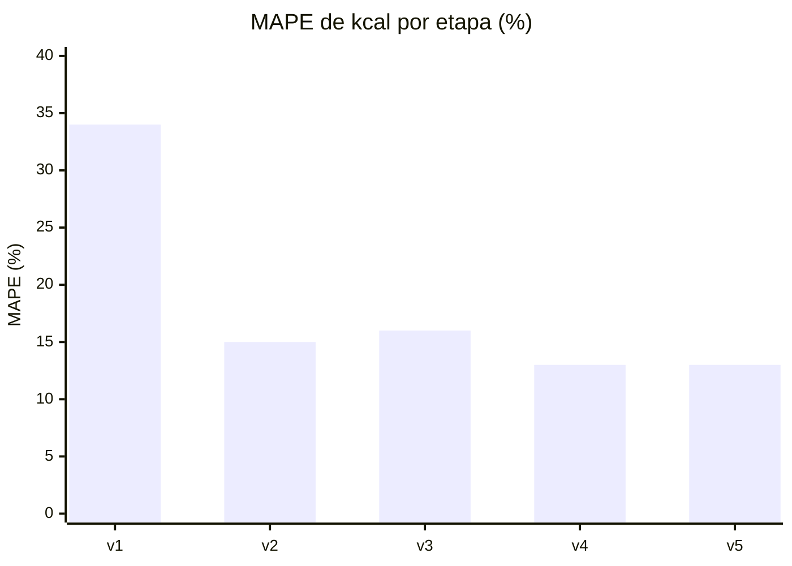
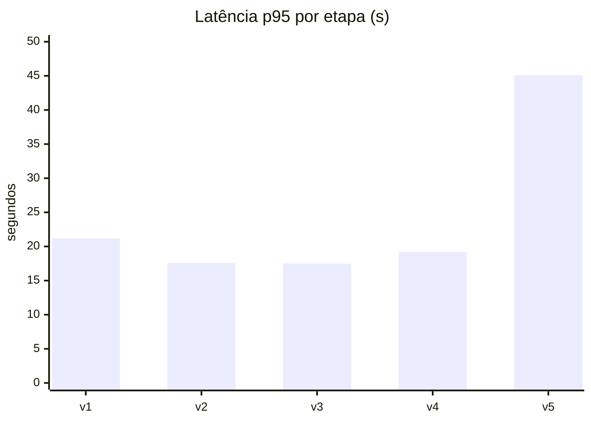

# Etapas e avaliação

O projeto evolui em **etapas comparáveis**. Cada etapa é um pipeline completo, avaliado no **mesmo conjunto de teste**, com o mesmo modelo e a mesma base. Nenhuma etapa é apagada: todas continuam rodando para que a comparação possa ser refeita.

## Evolução

| Etapa | Nome | Pipeline | Mapeamento | MAPE kcal | Latência p95 | Situação |
| --- | --- | --- | --- | --- | --- | --- |
| 0 | Fundação: dados, conjunto, cálculo, avaliador | `p0_gabarito` | 1,00 | 0% | < 1 ms | Concluída |
| 1 | Baseline sem RAG (LLM estima tudo) | `v1_baseline` | — | 34% | 21,2 s | Concluída |
| 2 | RAG à mão: BM25 + embeddings + RRF | `v2_rag_manual` | 88% | 15% | 17,6 s | Concluída |
| 3 | RAG com framework (LangChain) | `v3_rag_framework` | 85% | 16% | 17,5 s | Concluída |
| 4 | RAG com PostgreSQL + pgvector | `v4_rag_banco` | 85% | 13% | 19,2 s | Concluída |
| 5 | Orientação com o Guia (+ base ampliada) | `v5_rag_completo` / ampliado | 85% | 13% | 45,1 / 28,6 s | Concluída |
| 6 | MVP demonstrável: API + interface | configurável | — | — | — | Concluída |
| 7 | Relatório comparativo | — | — | — | — | **Pendente** |

- **Recall@3 = 1,00** da Etapa 2 em diante: a busca sempre traz o alimento certo; os erros restantes vêm da **escolha** da LLM.
- LLM de todas as etapas: **Qwen 2.5 7B local** (ADR-014).

!!! note "Latência da v5"
    A v5 aparece com dois valores, 45,1 s e 28,6 s, correspondentes a `v5_rag_completo` e à variante "ampliado". O gráfico mostra o primeiro.

!!! warning "TODO"
    - Confirmar a qual variante cada latência da v5 corresponde.
    - Definir formalmente as métricas **Mapeamento** e **MAPE kcal** (fórmula e unidade de agregação).
    - Registrar o tamanho do conjunto de teste usado em cada linha (hoje 15 refeições; meta: 40).

## Métricas

| Métrica | O que mede |
| --- | --- |
| Mapeamento | TODO: definição formal (ver bloco acima). |
| MAPE kcal | Erro percentual absoluto médio (*Mean Absolute Percentage Error*) das calorias em relação ao gabarito (`p0_gabarito`). |
| Recall@3 | Se o alimento correto está entre os 3 primeiros candidatos da busca. |
| Latência p95 | Tempo de resposta no percentil 95. |

## Próximos passos de avaliação

- Completar o conjunto anotado (15 → 40 refeições) e criar um conjunto de validação sem curadoria.
- Investigar erros de escolha: testar `qwen2.5:14b` e a sensibilidade à ordem dos candidatos.
- Validar o LLM-juiz da orientação (kappa) e melhorar a fidelidade da orientação.
- Produzir o relatório comparativo da Etapa 7.

Como rodar a avaliação: [Avaliar um pipeline](../guides/avaliar-pipeline.md).

**Fonte:** [Estrutura do Mira](../assets/pdfs/estrutura-mira.pdf), seções 4 e 6.
