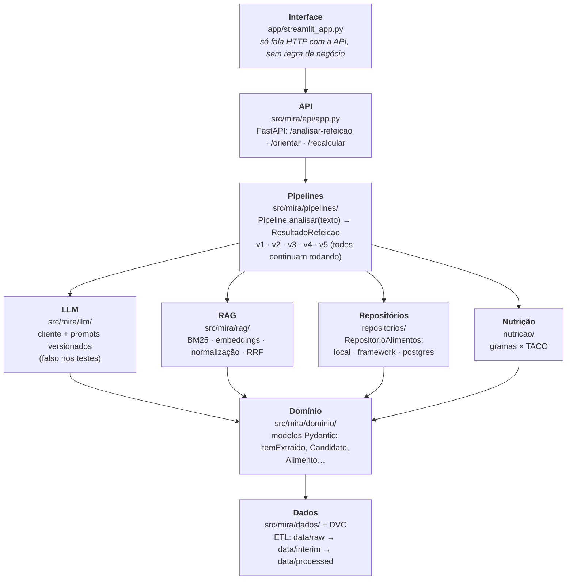

# Arquitetura

## Visão em camadas

Cada camada só conhece a de baixo, por meio de uma interface. É isso que permite trocar implementação em memória por framework ou banco, ou texto por foto, sem mexer no resto.

## Componentes de infraestrutura

| Componente | Tecnologia | Papel |
| --- | --- | --- |
| Interface | Streamlit | Demonstração do MVP. |
| API | FastAPI (servida com Uvicorn) | Expõe os pipelines via HTTP. Ver [API HTTP](../reference/api.md). |
| LLM | Qwen 2.5 7B local via Ollama (ADR-014) | Extração, escolha e orientação. Clientes alternativos: Anthropic e falso. |
| Banco | PostgreSQL + pgvector | Alimentos, medidas, sinônimos e trechos do Guia. Ver [Banco de dados](../reference/dados.md). |
| Dados | DVC | Versionamento e reprodução do ETL. |
| Busca | BM25 + embeddings + RRF (manual, LangChain ou pgvector) | Recuperação de candidatos e trechos. |

## Nesta seção

- [Pipeline de uma refeição](pipeline-refeicao.md) — os 6 passos do pipeline v5.
- [Etapas e avaliação](etapas.md) — evolução v1 → v5 e métricas comparativas.
- [Regras fixas e ADRs](decisoes.md) — o que só muda com um ADR.
- [Visão computacional (fase 2)](visao-computacional.md) — arquitetura de referência para foto e código de barras.

!!! warning "TODO"
    Documentar o modelo de embeddings usado na busca vetorial e a dimensão dos vetores no pgvector.

**Fonte:** [Estrutura do Mira](../assets/pdfs/estrutura-mira.pdf), seções 1 e 2.
