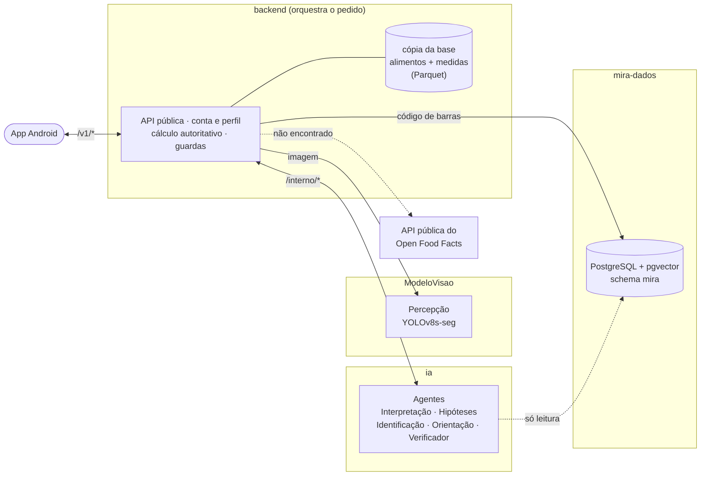
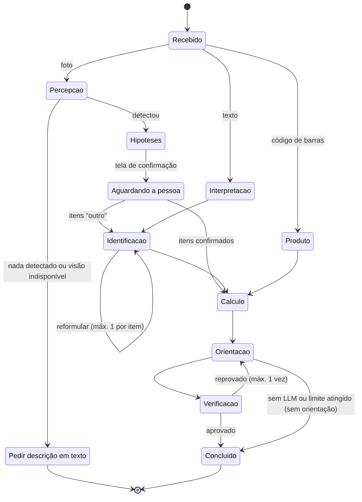
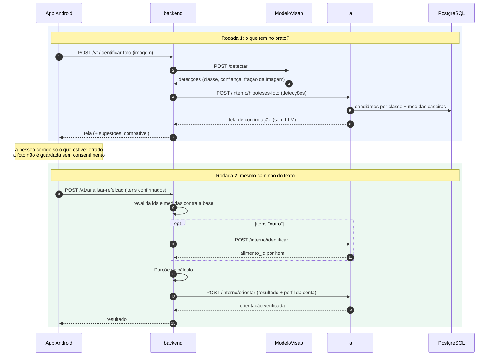

# Sistema multiagentes multimodal (proposta)

!!! info "Situação: proposta"
    Ainda não há implementação nem ADR aceito. Esta página reúne a proposta para discussão da equipe. Os dados que as ferramentas usam já estão no banco publicado pelo `mira-dados` (schema `0002`), o detector de alimentos já existe no [`ModeloVisao`](https://github.com/residencia-ia-Challenge-2/ModeloVisao) (ver [Visão computacional](visao-computacional.md)), e o [`backend`](https://github.com/residencia-ia-Challenge-2/backend) já atende o app Android com texto, foto e código de barras.

## Ideia central

**O `backend` continua orquestrando cada pedido do app. Os agentes ficam dentro dos passos que o `ia` já expõe (identificar, orientar e, novo, montar as hipóteses da foto). Os três canais de entrada (texto, foto e código de barras) convergem para o mesmo cálculo e a mesma orientação.**

| Princípio | Por quê |
| --- | --- |
| O `backend` orquestra o pedido | Ele já chama a visão e o `ia`, faz o cálculo e recusa resposta da IA que altere números. É a menor mudança e mantém a autoridade sobre os números onde já está |
| Fluxo definido em código, não agentes conversando livremente | O p95 do v5 já está entre 17,5 s e 45,1 s (ver [Etapas](etapas.md)); a meta do RNF01 é menos de 3 s |
| LLM só onde há ambiguidade | Interpretar texto, escolher entre candidatos e escrever a orientação. Montar a tela de confirmação da foto é código |
| Números só da base | Gramas vêm de medida caseira (ou, no futuro, de estimativa determinística por imagem); nutrientes vêm de `gramas × valor por 100 g` |
| A visão sugere, a pessoa confirma | O detector atual tem mAP50 de 0,46 em 12 categorias grosseiras |
| Perfil vem da conta, com consentimento | Condição de saúde é dado sensível (LGPD, art. 11). Não se infere perfil a partir do texto da refeição |
| Ferramentas só de leitura | Quem carrega o banco é o `mira-dados` |

## Visão geral



| Repositório | Papel no sistema multiagentes |
| --- | --- |
| `backend` | **Orquestrador do pedido.** Porta de entrada do app, dono da conta e do perfil, do **cálculo autoritativo** (com a cópia própria de `alimentos` e `medidas`) e das guardas que já existem (id fora dos candidatos ou números alterados pela IA = erro 502). Também é dono do canal de código de barras. |
| `ModeloVisao` | Agente de **Percepção**: detecta categorias de alimento na foto. |
| `ia` | Agentes com LLM e as ferramentas de leitura do banco. Cada rota `/interno/*` coordena os agentes do seu passo. |
| `mira-dados` | Base de leitura das ferramentas, produtos com checagem de qualidade (`produtos_ean`) e uma curadoria nova: **classe da visão → alimentos candidatos**. |

!!! note "A base vive em três lugares"
    O PostgreSQL do `mira-dados`, os Parquets do `ia` e os Parquets do `backend`. Hoje o `backend` compara o `versao_base` que o `ia` devolve com o hash da própria cópia e recusa o pedido se forem diferentes. Essa guarda continua valendo no sistema multiagentes.

## Agentes

| Agente | Canal | Tipo | Onde roda | Entrada → saída | Ferramentas (tabelas) |
| --- | --- | --- | --- | --- | --- |
| **Interpretação** | Texto | LLM | `ia` | texto → `list[ItemExtraido]` | — |
| **Percepção** | Foto | Código (YOLO) | `ModeloVisao` | imagem → `list[Deteccao]` (classe, confiança, fração da imagem) | — |
| **Hipóteses** | Foto | Código | `ia` | detecções → uma `TelaConfirmacao` com o candidato e a medida mais prováveis já marcados | `classes_visao`, `alimentos`, `medidas` |
| **Produtos** | Código de barras | Código | `backend` | GTIN → produto | `produtos_ean`; API do Open Food Facts quando não encontrado |
| **Identificação** | Texto e foto ("outro") | LLM | `ia` | item + candidatos → `alimento_id` ou `null`; reformula a busca 1 vez | busca híbrida, trigramas (`alimentos`, `sinonimos`) |
| **Porções e cálculo** | Todos | Código | `backend` (autoritativo) e `ia` (avaliação) | id + quantidade + unidade → gramas e nutrientes | cópia da base no `backend` |
| **Orientação** | Todos | LLM | `ia` | itens + perfil da conta → até 2 frases citando `trecho_id` ou `regra_id` | `trechos_ampliados` com filtro por público, `regras_oficiais` |
| **Verificador** | Todos | Código | `ia` | orientação → aprovada ou reprovada | — |

As peças em que a autonomia de agente acrescenta algo são duas: a **Identificação** (laço de reformulação da busca) e a **Orientação** (escolha de filtro e de fonte). As demais são código.

### Canal de foto em detalhe

**Percepção.** O serviço atual devolve só rótulos sem repetição (`["arroz", "carne"]`) e descarta máscaras, caixas e confianças. A proposta é um endpoint novo, `POST /detectar`, que devolve uma `Deteccao` por objeto. O detector não tem classe de prato, então a área é medida como **fração da imagem**. `POST /identificar` continua igual, para não quebrar o app.

**Hipóteses.** Cada classe do detector vira uma lista curta de alimentos da base, a partir de uma tabela curada no `mira-dados` (`classes_visao.csv`, a "rotulação multimodal" que ele já prevê em `data/rotulos/visao/`):

| Classe | Alimentos candidatos (exemplo) |
| --- | --- |
| `Arroz` | arroz branco cozido, arroz integral cozido |
| `Grao` | feijão carioca cozido, feijão preto cozido, lentilha cozida |
| `CarneV`, `CarneB`, `CarneP` | todas as carnes da curadoria, até o significado das letras ser documentado |
| `Tuberculo` | batata cozida, mandioca cozida, batata-doce cozida |

A ordem dos candidatos vem da curadoria. Para cada candidato, as opções de quantidade são as medidas caseiras da base (`concha`, `colher de servir`…).

**Tela de confirmação (sem LLM).** Em vez de perguntas uma a uma, o agente de Hipóteses monta **uma tela única**: uma linha por item detectado, com o alimento mais provável e a medida típica **já marcados**. A pessoa só toca no que quer corrigir, o que cabe nos 3 toques do RNF02 mesmo num prato com 4 ou 5 itens. A tela pode incluir uma linha opcional para ingredientes que a foto não mostra (óleo, manteiga — Risco 2). Montar a tela é código: o texto das opções sai da base, e a LLM não entra, o que economiza uma chamada.

**Porção por imagem (futuro).** Estimar gramas pela área da máscara exige um objeto de referência (RF07: talher, que o modelo atual não detecta) e densidades por alimento validadas por nutricionista. Quando existir, é **código**, e o valor entra como quantidade pré-marcada na tela, não como número final.

## Orquestração

### Quem coordena o quê

| Nível | Quem | O que decide |
| --- | --- | --- |
| Pedido | `backend` | Ordem dos passos (visão → hipóteses → confirmação da pessoa → identificação → cálculo → orientação), tempos limite, alternativas quando algo falha e guardas sobre os números |
| Passo | Rota `/interno/*` do `ia` | Agentes do passo: reformular ou não a busca, qual filtro usar, refazer a orientação reprovada |

### Contratos novos

Os modelos que já existem (`ItemExtraido`, `ItemResultado`, `ResultadoRefeicao` em `src/mira/dominio/`) continuam valendo. A proposta acrescenta:

```python
class Perfil(Modelo):                          # vem da conta, com consentimento explícito
    publico_alvo: str | None = None            # "adultos", "idosos"...; None = sem informação
    condicoes: list[str] = []                  # "diabetes", "hipertensao"...

class Deteccao(Modelo):                        # saída do POST /detectar do ModeloVisao
    classe: str                                # "Grao"
    rotulo: str                                # "grão"
    confianca: float = Field(ge=0, le=1)
    fracao_imagem: float | None = Field(default=None, ge=0, le=1)

class Opcao(Modelo):
    opcao_id: str                              # alimento_id ou nome da medida, sempre da base
    texto: str

class LinhaConfirmacao(Modelo):
    deteccao: int                              # índice em deteccoes
    alimentos: list[Opcao]                     # o primeiro vem pré-marcado
    medidas: list[Opcao]                       # a primeira vem pré-marcada

class TelaConfirmacao(Modelo):                 # saída do POST /interno/hipoteses-foto
    deteccoes: list[Deteccao]
    linhas: list[LinhaConfirmacao]

class ItemConfirmado(Modelo):                  # entrada nova do /v1/analisar-refeicao
    alimento_id: str | None                    # None = "outro": vai para a Identificação
    nome: str                                  # texto digitado quando alimento_id é None
    quantidade: float | None = Field(default=None, gt=0)
    unidade: str | None = None

class Evento(Modelo):                          # trilha de auditoria, um por agente
    agente: str
    duracao_s: float
    chamadas_llm: int
    decisao: str
```

!!! note "Trilha de auditoria"
    O campo `diagnostico` de `ResultadoRefeicao` é `dict[str, float | str | None]` e não comporta uma lista. A trilha de `Evento` precisa de um campo próprio (por exemplo, `eventos: list[Evento]`), não exibido ao usuário.

### Fluxo de cada pedido



### Fluxo do texto

```mermaid
sequenceDiagram
    autonumber
    participant App as App Android
    participant BE as backend
    participant IA as ia
    participant DB as PostgreSQL

    App->>BE: POST /v1/analisar-refeicao (texto)
    BE->>IA: POST /interno/identificar
    IA->>IA: Interpretação (LLM): itens
    loop cada item
        IA->>DB: busca híbrida + trigramas
        IA->>IA: Identificação (LLM): id da lista, ou reformula 1 vez
    end
    IA-->>BE: alimento_id por item + versao_base
    BE->>BE: confere versao_base; Porções e cálculo
    BE->>IA: POST /interno/orientar (resultado + perfil da conta)
    IA->>DB: trechos filtrados por público + regras oficiais
    IA->>IA: Orientação (LLM) → Verificador (código)
    IA-->>BE: orientação aprovada (ou sem orientação)
    BE->>BE: confere que itens e totais não mudaram
    BE-->>App: resultado
```

### Fluxo da foto (duas rodadas)

A foto tem uma pausa no meio: a pessoa confirma a tela. Para não guardar estado nem foto no servidor, a tela vai na resposta da rodada 1, as escolhas voltam na rodada 2, e o `backend` revalida todos os ids e medidas contra a própria cópia da base.



### Fluxo do código de barras

Já existe no `backend` (`GET /v1/produtos/{codigo}` e `POST /v1/produtos/calcular`), consultando **ao vivo** a API pública do Open Food Facts, com cache de 1 hora e limite de 15 consultas por minuto. A proposta é consultar primeiro a tabela `produtos_ean` do `mira-dados`, que passou pela checagem de qualidade (Atwater, faixas, sem dados de contribuidores), e usar a API ao vivo só quando o código não estiver na base.

### Regras de orquestração

| Regra | Proposta (a fixar no ADR depois de medir) |
| --- | --- |
| Chamadas de LLM por refeição | Hoje: 1 de interpretação + 1 de escolha **por item** + 1 de orientação. A proposta acrescenta no máximo 1 reformulação por item e 1 nova tentativa de orientação. Fazer a escolha em lote reduziria chamadas, mas é uma mudança que precisa de ablação |
| Confirmação da foto | Uma tela, com tudo pré-marcado; toques só para corrigir |
| Tempos limite | A definir **depois de medir** o p95 de cada passo. Hoje o `backend` espera até 90 s pela visão |
| Paralelismo | Limitado: o `ia` atende um pedido por vez por pipeline (`lock`), o `ModeloVisao` também, e o Ollama local só processa em paralelo se configurado para isso. Medir antes de prometer ganho |
| Atalho determinístico | Candidato único com similaridade de trigramas alta: pula a escolha pela LLM |
| Alternativa quando a visão falha | Nada detectado, confiança baixa em tudo ou serviço indisponível: pedir a descrição em texto |
| Alternativa quando a LLM falha | Resultado sem orientação (`orientacao_disponivel = false`, como já existe) |
| Item sem candidato ou sem medida | `SEM_ALIMENTO` ou `SEM_MEDIDA`; nenhum número inventado |
| Autoridade dos números | O `backend` recalcula e recusa resposta da IA que altere itens ou totais (já implementado) |
| Base sincronizada | O `backend` confere o `versao_base` devolvido pelo `ia` (já implementado) |

### Endpoints

| Repositório | Endpoint | Situação |
| --- | --- | --- |
| `backend` | `POST /v1/identificar-foto` | Existe. Passa a devolver a tela de confirmação, mantendo `sugestoes` |
| `backend` | `POST /v1/analisar-refeicao` | Existe (só `texto`). Passa a aceitar `ItemConfirmado` |
| `backend` | `GET /v1/produtos/{codigo}`, `POST /v1/produtos/calcular` | Existem (API do OFF ao vivo). Passam a consultar `produtos_ean` primeiro |
| `ModeloVisao` | `POST /identificar` | Existe (só rótulos) |
| `ModeloVisao` | `POST /detectar` | **Novo**: detecções com classe, confiança e fração da imagem |
| `ia` | `POST /interno/identificar` | Existe. Ganha a reformulação da busca |
| `ia` | `POST /interno/hipoteses-foto` | **Novo**: monta a tela de confirmação |
| `ia` | `POST /interno/orientar` | Existe. Passa a receber o perfil e a citar regras oficiais |

## Ferramentas

As consultas seguem o [contrato de leitura para RAG e agentes](https://github.com/residencia-ia-Challenge-2/data/blob/main/docs/arquitetura/rag_agentes.md) do `mira-dados`:

| Ferramenta | Consulta | Observação |
| --- | --- | --- |
| `buscar_alimento(termo)` | Busca híbrida (full-text + vetores + RRF) e trigramas em `alimentos.nome` e `sinonimos.termo` | Pega sinônimos regionais (`macaxeira` → mandioca) |
| `medidas_e_grupo(alimento_id)` | `medidas` + `grupos_guia` | Ordem das medidas por `id` |
| `candidatos_da_classe(classe)` | `classes_visao` + `alimentos` | **Nova**, depende da curadoria no `mira-dados` |
| `buscar_trechos(consulta, perfil)` | `trechos_ampliados` com `publico_alvo IN (...)` e `condicao_saude` | `NULL` = "sem informação", não "geral". Com filtro seletivo, aumentar `hnsw.ef_search` |
| `regras_oficiais(tipo)` | `regras_oficiais` + trecho de origem | 15 regras transcritas literalmente do Guia |
| `buscar_produto(gtin)` | `produtos_ean` | Usada pelo `backend` |

## Regras fixas aplicadas aos agentes

| Regra | Como o sistema garante |
| --- | --- |
| Números só da base | Só o agente de Porções e cálculo (código) produz números; o `backend` recalcula. O Verificador reprova orientação com números. |
| Escolha só entre candidatos | Identificação devolve `Optional[Literal[ids recuperados]]`; na foto, as opções da tela saem da base e o `backend` revalida. |
| Toda saída de LLM passa por Pydantic | Cada agente com LLM tem um modelo de saída próprio. |
| Não inventar dados | Classe sem significado documentado (`CarneV/B/P`) não vira espécie; vira escolha na tela. |
| LGPD | Foto e perfil de saúde só com consentimento explícito (RNF04). Sem consentimento, nenhuma imagem é guardada e a orientação usa só trechos gerais. |
| Avaliação separada | O gabarito (`eval/`) nunca vira ferramenta nem exemplo de prompt. |

## Implementação por repositório

=== "backend"

    - Continua orquestrando o pedido; acrescenta a sequência da foto em duas rodadas.
    - `/v1/identificar-foto`: chamar `/detectar` e `/interno/hipoteses-foto`; devolver a tela mantendo `sugestoes`.
    - `/v1/analisar-refeicao`: aceitar `ItemConfirmado` e revalidar ids e medidas contra a base.
    - Conta: perfil (público e condições) com consentimento explícito e revogável. Hoje a conta só tem usuário e senha.
    - Produtos: consultar `produtos_ean` antes da API ao vivo.
    - Manter as guardas atuais: id fora dos candidatos, números alterados pela IA ou `versao_base` diferente = erro.

=== "ia"

    ```text
    src/mira/agentes/
    ├── ferramentas.py     # consultas de leitura, via RepositorioPostgres
    ├── interpretacao.py
    ├── hipoteses.py       # classe da visão → tela de confirmação (código)
    ├── identificacao.py   # escolha + reformulação da busca
    ├── orientacao.py
    └── verificador.py
    src/mira/pipelines/v6_multiagentes.py   # @registrar("v6_multiagentes")
    ```

    - A pipeline cumpre `Pipeline.analisar(texto) -> ResultadoRefeicao` e entra em `MODULOS`: o canal de **texto** é avaliado pelo mesmo `eval/run_eval.py` e vira a **Etapa 8**.
    - O protocolo `Pipeline` só recebe texto, então o canal de **foto** precisa de um avaliador próprio, com o conjunto de fotos.
    - Agentes usam o `LLMClient` atual (Ollama, Anthropic ou falso); testes sem rede.
    - Primeiro em Python puro; depois, se valer a pena, a variante `v6_langgraph`, como foi feito no v2 (manual) e no v3 (framework).

=== "ModeloVisao"

    - `POST /detectar` com uma detecção por objeto (classe, confiança, área da máscara, fração da imagem).
    - Documentar as classes `CarneV`, `CarneB`, `CarneP`, a origem e a licença do dataset, e o processo de treino.
    - Medir o p95 do serviço (CPU, um pedido por vez).

=== "mira-dados"

    - Curadoria `data/rotulos/visao/classes_visao.csv`: `classe`, `alimento_id`, `prioridade`, `status`, `evidencia_fonte`.
    - Estágio no `dvc.yaml`, tabela `classes_visao` numa migração Alembic e regra no Data Quality Gate (todo `alimento_id` existe; toda classe do detector tem ao menos um candidato).
    - Garantir que o `backend` receba a mesma versão da base que o `ia` (hoje cada um tem a sua cópia dos Parquets).

## Avaliação

Mesmo modelo e mesma base para todas as variantes, como manda a regra de comparação justa.

| Canal | Métrica | Origem |
| --- | --- | --- |
| Texto | Mapeamento, MAPE de kcal, Recall@3, latência p95 | As mesmas das [etapas](etapas.md), pelo `run_eval.py` |
| Texto | Precisão de contexto e fidelidade da orientação | LLM-juiz |
| Texto | Chamadas de LLM por refeição; taxa de reformulação e acerto depois dela; reprovação no Verificador; itens em `null` | Novas |
| Foto | mAP50 de máscara e por classe | Modelo |
| Foto | Cobertura: o alimento certo estava entre as opções da tela | Nova, avaliador de foto |
| Foto | Taxa de confirmação sem correção | Nova; corresponde ao KPI "taxa de intervenção manual < 15 %" |
| Foto | Toques e tempo total de registro | KPIs de até 3 toques e menos de 8 s |
| Foto | MAPE de kcal do resultado final | Contra o gabarito da foto |
| Código de barras | Taxa de produtos encontrados em `produtos_ean` × na API ao vivo | Nova |

O canal de foto precisa de um **conjunto de fotos com gabarito** (itens e gramas), separado do `eval/` de texto e coletado com consentimento.

## Roteiro

| Passo | Entrega | Critério de pronto |
| --- | --- | --- |
| 0 | ADR: divisão `backend` × `ia`, agentes, limites de chamadas e de tempo | ADR aceito pela equipe |
| 1 | Pré-requisitos: nova linha de base do `v5_rag_ampliado`; medir o p95 de cada passo (texto, visão, orientação) | Resultados registrados |
| 2 | Ferramentas e `v6_multiagentes` com **paridade** com o v5 (texto) | Métricas equivalentes às do v5 |
| 3 | Capacidades novas do texto, uma por vez, com ablação: reformulação, regras oficiais, Verificador | Ganho medido sem piorar o p95 além do limite do ADR |
| 4 | Perfil na conta com consentimento; filtro por público na orientação | Precisão de contexto medida com e sem filtro |
| 5 | Visão: `POST /detectar` e curadoria `classes_visao` | Toda classe com candidatos; Data Quality aprovado |
| 6 | Hipóteses e tela de confirmação; `/interno/hipoteses-foto`; integração no `backend` e no app | Fluxo de duas rodadas funcionando ponta a ponta |
| 7 | Conjunto de fotos com gabarito e avaliador de foto | Métricas de foto registradas |
| 8 | Produtos: `produtos_ean` primeiro, API ao vivo quando não encontrado | Taxa de cobertura medida |
| 9 | Porção por imagem (objeto de referência + densidades validadas) | Estimativa comparada com a medida confirmada |
| 10 | (Opcional) Variante `v6_langgraph` | Comparação manual × framework registrada |

## Riscos

| Risco | Mitigação |
| --- | --- |
| Latência maior que a do v5 | Limite de chamadas, atalho determinístico, tela de confirmação sem LLM, cache |
| Acurácia baixa da visão (mAP50 0,46) | Confirmação obrigatória; a visão só restringe as opções. Retreino com as correções feitas no app |
| Classes ambíguas (`CarneV/B/P`) | Viram escolha na tela; documentar com quem treinou o modelo |
| Base em três cópias (PostgreSQL, Parquets do `ia` e do `backend`) | Guarda de `versao_base` no `backend`; publicação coordenada pelo `mira-dados` |
| Duas fontes de produtos (base e API ao vivo) com qualidade diferente | `produtos_ean` primeiro; registrar a fonte de cada produto no resultado |
| Escolha da LLM pouco confiável no Qwen 2.5 7B | Saída estruturada com Pydantic; o fluxo é decidido em código |
| Curadoria de público, regras e classes ainda não revisada | Vale só em dev até a revisão da equipe |
| Foto e perfil de saúde são dados sensíveis (LGPD) | Consentimento explícito e revogável; sem ele, nada é guardado |
| Licença do Ultralytics (AGPL-3.0) num serviço em rede | Avaliar com a equipe e os mentores antes de publicar |
| Conjuntos de avaliação pequenos | Texto: 40 ou mais refeições com parcela cega. Foto: conjunto próprio antes de concluir sobre o canal |

??? example "Rascunho de ADR"

    ```markdown
    # ADR-NNN: Sistema multiagentes multimodal

    - **Data:** AAAA-MM-DD
    - **Situação:** proposto
    - **Autores:** <nomes>

    ## Contexto
    O v5 é um pipeline fixo de texto. O backend já orquestra os pedidos do app (texto, foto com
    sugestões do ModeloVisao e código de barras pela API do Open Food Facts), faz o cálculo e
    recusa respostas da IA que alterem números. A base 0002 do mira-dados trouxe filtros por
    público, regras oficiais e produtos EAN com checagem de qualidade. O detector tem mAP50 de
    máscara de 0,46. A latência atual (p95 de 17,5 s a 45,1 s) não comporta agentes livres.

    ## Decisão
    O backend continua orquestrando cada pedido. Os agentes ficam dentro das rotas /interno/*
    do ia: Interpretação, Identificação (com 1 reformulação por item), Orientação e Verificador.
    A foto segue em duas rodadas, sem estado no servidor: o ModeloVisao detecta, o ia monta uma
    tela de confirmação sem LLM, e a pessoa corrige só o que estiver errado. O perfil vem da
    conta, com consentimento. Produtos consultam produtos_ean antes da API ao vivo.

    ## Consequências
    - Nova etapa comparável para texto (v6_multiagentes, mesmo eval/) e um avaliador de foto.
    - Novos endpoints: /detectar (ModeloVisao) e /interno/hipoteses-foto (ia).
    - Novos contratos: Perfil, Deteccao, TelaConfirmacao, ItemConfirmado, Evento.
    - Nova curadoria classes_visao no mira-dados.
    - As regras fixas continuam valendo; o backend e o Verificador as checam em código.
    ```

!!! warning "TODO"
    - Medir o p95 de cada passo antes de fixar limites de chamadas e de tempo.
    - Definir o limite de confiança da visão abaixo do qual o app pede a descrição em texto.
    - Decidir se a escolha do alimento continua por item ou passa a ser em lote (com ablação).
    - Definir os campos de perfil e o texto de consentimento na conta.
    - Decidir se a variante com LangGraph entra no escopo da Etapa 8.

??? info "Histórico desta proposta"
    A primeira versão, escrita a partir do `ia` e do `mira-dados`, colocava o orquestrador no `ia`, extraía o perfil do texto da refeição pela LLM, usava a LLM para formular até 3 perguntas sobre a foto e tratava o código de barras como feature futura. A conferência com o código do `backend` mostrou que ele já orquestra os pedidos, faz o cálculo com uma cópia própria da base e já atende código de barras pela API do Open Food Facts. A proposta foi ajustada a isso.

**Fontes:** `docs/ANDAMENTO_RAG_MULTIAGENTES.md`, `src/mira/service/app.py` e `src/mira/pipelines/rag_comum.py` do `ia`; `README.md` e `service/app.py` do [`ModeloVisao`](https://github.com/residencia-ia-Challenge-2/ModeloVisao); `src/mira_backend/app.py`, `produtos.py` e `auth.py` do [`backend`](https://github.com/residencia-ia-Challenge-2/backend); [`mira-dados`: Contrato de leitura para RAG e agentes](https://github.com/residencia-ia-Challenge-2/data/blob/main/docs/arquitetura/rag_agentes.md) e [Curadoria](https://github.com/residencia-ia-Challenge-2/data/blob/main/docs/definicao/curadoria.md).
