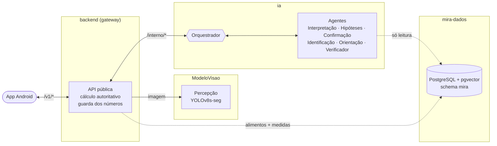
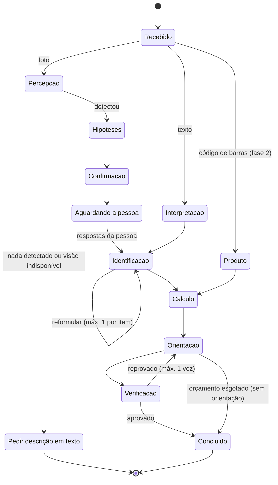
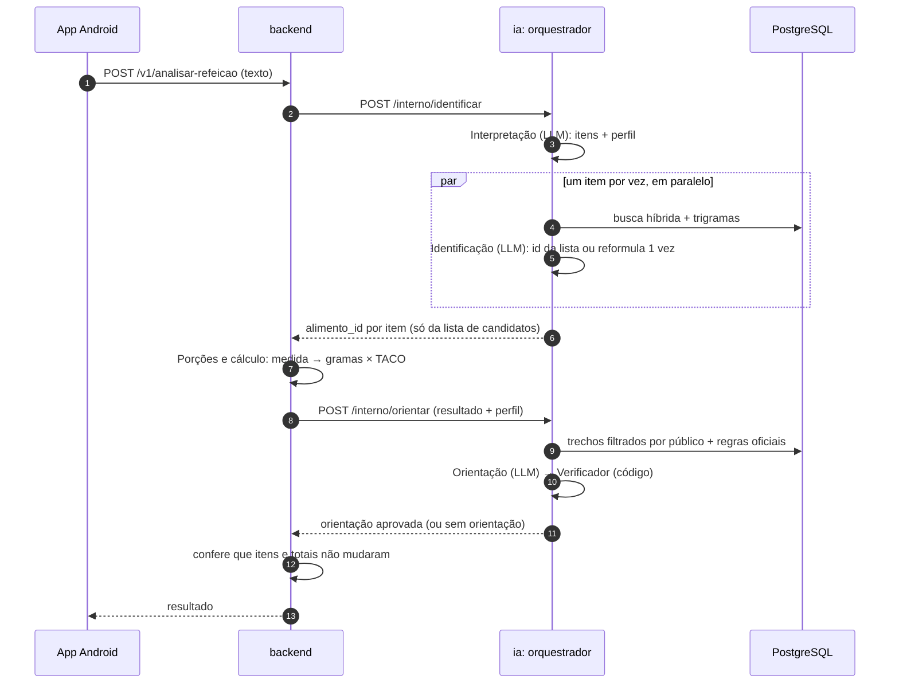
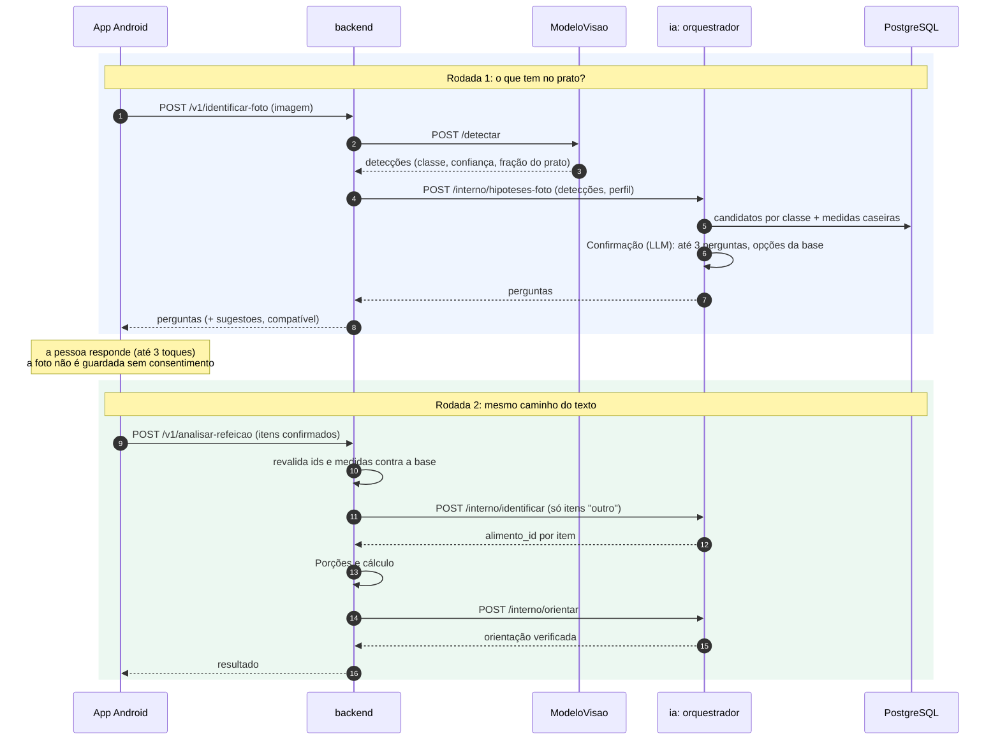

# Sistema multiagentes multimodal (proposta)

!!! info "Situação: proposta"
    Ainda não há implementação nem ADR aceito. Esta página reúne a proposta para discussão da equipe. Os dados que as ferramentas usam já estão no banco publicado pelo `mira-dados` (schema `0002`), e o detector de alimentos já existe no [`ModeloVisao`](https://github.com/residencia-ia-Challenge-2/ModeloVisao) (ver [Visão computacional](visao-computacional.md)).

## Ideia central

**Um orquestrador em código coordena agentes especialistas para três canais de entrada (texto, foto e, na fase 2, código de barras). Todos os canais convergem para os mesmos agentes de cálculo e orientação.**

| Princípio | Por quê |
| --- | --- |
| Orquestrador em código, não agentes conversando livremente | O p95 do v5 já está entre 17,5 s e 45,1 s com 3 chamadas de LLM (ver [Etapas](etapas.md)); a meta do RNF01 é menos de 3 s |
| LLM só onde há ambiguidade | Interpretar texto, escolher entre candidatos, formular perguntas e escrever a orientação. O resto é código |
| Números só da base | Gramas vêm de medida caseira (ou, no futuro, de estimativa determinística por imagem); nutrientes vêm de `gramas × valor por 100 g` |
| A visão sugere, a pessoa confirma | O detector atual tem mAP50 de 0,46 em 12 categorias grosseiras. Nada detectado na foto vira registro sem confirmação |
| Ferramentas só de leitura | Quem carrega o banco é o `mira-dados` |

## Visão geral



| Repositório | Papel no sistema multiagentes |
| --- | --- |
| `backend` | Porta de entrada do app. Chama a visão e o `ia`, faz o **cálculo autoritativo** (gramas × TACO) e recusa resposta da IA que altere números ou escolha id fora dos candidatos (já faz isso hoje). |
| `ModeloVisao` | Agente de **Percepção**: detecta categorias de alimento na foto. |
| `ia` | **Orquestrador** e agentes com LLM. Exposto ao `backend` por `/interno/*`. |
| `mira-dados` | Base de leitura das ferramentas e curadoria da tabela **classe da visão → alimentos candidatos**. |

## Agentes

| Agente | Canal | Tipo | Onde roda | Entrada → saída | Ferramentas (tabelas) |
| --- | --- | --- | --- | --- | --- |
| **Interpretação** | Texto | LLM | `ia` | texto → `list[ItemExtraido]` + `Perfil` | — |
| **Percepção** | Foto | Código (YOLO) | `ModeloVisao` | imagem → `list[Deteccao]` (classe, confiança, fração do prato) | — |
| **Hipóteses** | Foto | Código | `ia` | detecções → alimentos e medidas candidatos por detecção | `classes_visao`, `alimentos`, `medidas` |
| **Confirmação** | Foto | LLM | `ia` | hipóteses → até 3 `Pergunta` com opções **só da base** | — |
| **Produtos** (fase 2) | Código de barras | Código | `ia` | GTIN → produto | `produtos_ean` |
| **Identificação** | Texto e foto | LLM | `ia` | item + candidatos → `alimento_id` ou `null`; reformula a busca 1 vez | busca híbrida, trigramas (`alimentos`, `sinonimos`) |
| **Porções e cálculo** | Todos | Código | `backend` (autoritativo) e `ia` (avaliação) | id + quantidade + unidade → gramas e nutrientes | `medidas`, `alimentos` |
| **Orientação** | Todos | LLM | `ia` | itens + perfil → até 2 frases citando `trecho_id` ou `regra_id` | `trechos_ampliados` com filtro por público, `regras_oficiais` |
| **Verificador** | Todos | Código | `ia` | orientação → aprovada ou reprovada | — |

As peças em que a autonomia de agente acrescenta algo são três: a **Identificação** (laço de reformulação da busca), a **Confirmação** (decidir o mínimo que precisa ser perguntado) e a **Orientação** (escolher filtro e fonte). As demais são código.

### Agentes do canal de foto em detalhe

**Percepção.** O serviço atual devolve só rótulos sem repetição (`["arroz", "carne"]`) e descarta máscaras, caixas e confianças. A proposta é um endpoint novo, `POST /detectar`, que devolve uma `Deteccao` por objeto. `POST /identificar` continua igual, para não quebrar o app.

**Hipóteses.** Cada classe do detector vira uma lista curta de alimentos da base, a partir de uma tabela curada no `mira-dados` (`classes_visao.csv`, a "rotulação multimodal" que ele já prevê em `data/rotulos/visao/`):

| Classe | Alimentos candidatos (exemplo) |
| --- | --- |
| `Arroz` | arroz branco cozido, arroz integral cozido |
| `Grao` | feijão carioca cozido, feijão preto cozido, lentilha cozida |
| `CarneV`, `CarneB`, `CarneP` | todas as carnes da curadoria, até o significado das letras ser documentado |
| `Tuberculo` | batata cozida, mandioca cozida, batata-doce cozida |

A ordem dos candidatos vem da curadoria, não da LLM. Para cada candidato, as opções de quantidade são as medidas caseiras da base (`concha`, `colher de servir`…).

**Confirmação.** A LLM recebe as hipóteses e devolve **no máximo 3 perguntas**, priorizando o que mais muda o resultado (o tipo de alimento antes do preparo; o preparo antes da quantidade). As opções de cada pergunta são `Literal` dos ids recebidos: a LLM escolhe **quais** perguntas fazer e **como** escrevê-las, nunca as opções. Uma pergunta opcional pode tratar ingredientes que não aparecem na foto (óleo, manteiga — Risco 2).

**Porção por imagem (futuro).** Estimar gramas pela área da máscara exige um objeto de referência (RF07: talher, que o modelo atual não detecta) e densidades por alimento validadas por nutricionista. Quando existir, é **código**, e o valor entra como sugestão de quantidade na pergunta, não como número final.

## Orquestração

### Estado compartilhado

Todos os agentes leem e escrevem um único estado tipado. O orquestrador é o único que decide a próxima etapa.

```python
class Canal(StrEnum):
    TEXTO = "texto"
    FOTO = "foto"
    CODIGO_BARRAS = "codigo_barras"

class Perfil(Modelo):
    publico_alvo: str | None = None            # "adultos", "idosos"...; None = sem informação
    condicoes: list[str] = []                  # "diabetes", "hipertensao"...

class Deteccao(Modelo):
    classe: str                                # "Grao"
    rotulo: str                                # "grão"
    confianca: float = Field(ge=0, le=1)
    fracao_prato: float | None = Field(default=None, ge=0, le=1)

class Opcao(Modelo):
    opcao_id: str                              # alimento_id ou nome da medida, sempre da base
    texto: str

class Pergunta(Modelo):
    pergunta_id: str
    deteccao: int | None                       # índice em deteccoes
    tipo: Literal["alimento", "preparo", "quantidade", "ingrediente_oculto"]
    texto: str
    opcoes: list[Opcao]

class Evento(Modelo):                          # trilha de auditoria
    agente: str
    duracao_s: float
    chamadas_llm: int
    decisao: str

class EstadoRefeicao(Modelo):
    canal: Canal
    etapa: str
    perfil: Perfil | None = None
    deteccoes: list[Deteccao] = []
    perguntas: list[Pergunta] = []
    itens: list[ItemExtraido] = []
    resultado: ResultadoRefeicao | None = None
    chamadas_llm: int = 0
    eventos: list[Evento] = []
```

`ItemExtraido` e `ResultadoRefeicao` são os modelos que já existem em `src/mira/dominio/` (ver [Contratos](../reference/contratos.md)). A trilha de `eventos` vai para o campo `diagnostico` do resultado.

### Máquina de estados



No canal de foto, itens confirmados com um `alimento_id` já escolhido pela pessoa **pulam** a Identificação. Só passam por ela os itens em que a pessoa escolheu "outro" e digitou um nome.

### Fluxo do texto



### Fluxo da foto (duas rodadas)

A foto tem uma pausa no meio: a pessoa precisa responder às perguntas. Para não guardar estado nem foto no servidor, as perguntas vão na resposta da rodada 1 e voltam junto com as respostas na rodada 2, e o `backend` revalida todos os ids contra a base.



### Regras do orquestrador

| Regra | Proposta inicial (a fixar no ADR) |
| --- | --- |
| Orçamento de LLM por refeição | Texto: no máximo 5 chamadas (Interpretação 1, Identificação 1 em lote + 1 reformulação, Orientação 1 + 1 refeita). Foto: +1 chamada na rodada 1 (Confirmação) |
| Limite de perguntas na foto | 3 perguntas por foto (RNF02: até 3 toques) |
| Tempo limite por agente | LLM 20 s; visão 10 s (hoje o `backend` espera até 90 s) |
| Paralelismo | Identificação dos itens em paralelo; busca de trechos em paralelo com o cálculo |
| Atalho determinístico | Candidato único com similaridade de trigramas alta: pula a escolha pela LLM |
| Fallback da visão | Nada detectado, confiança baixa em tudo ou serviço indisponível: pede a descrição em texto |
| Fallback da LLM | Sem LLM ou orçamento esgotado: resultado sem orientação (`orientacao_disponivel = false`, como já existe) |
| Item sem candidato ou sem medida | `SEM_ALIMENTO` ou `SEM_MEDIDA`; nenhum número inventado |
| Autoridade dos números | O `backend` recalcula e recusa resposta da IA que altere itens ou totais (já implementado) |
| Auditoria | Cada agente registra um `Evento` (duração, chamadas, decisão) em `diagnostico` |

### Endpoints

| Repositório | Endpoint | Situação |
| --- | --- | --- |
| `backend` | `POST /v1/identificar-foto` | Existe. Passa a devolver `perguntas`, mantendo `sugestoes` |
| `backend` | `POST /v1/analisar-refeicao` | Existe. Passa a aceitar itens confirmados, além de texto |
| `ModeloVisao` | `POST /identificar` | Existe (só rótulos) |
| `ModeloVisao` | `POST /detectar` | **Novo**: detecções com classe, confiança e fração do prato |
| `ia` | `POST /interno/identificar` | Existe. Passa a usar o orquestrador do v6 |
| `ia` | `POST /interno/hipoteses-foto` | **Novo**: Hipóteses + Confirmação |
| `ia` | `POST /interno/orientar` | Existe. Passa a receber o perfil |

## Ferramentas

As consultas seguem o [contrato de leitura para RAG e agentes](https://github.com/residencia-ia-Challenge-2/data/blob/main/docs/arquitetura/rag_agentes.md) do `mira-dados`:

| Ferramenta | Consulta | Observação |
| --- | --- | --- |
| `buscar_alimento(termo)` | Busca híbrida (full-text + vetores + RRF) e trigramas em `alimentos.nome` e `sinonimos.termo` | Pega sinônimos regionais (`macaxeira` → mandioca) |
| `medidas_e_grupo(alimento_id)` | `medidas` + `grupos_guia` | Ordem das medidas por `id` |
| `candidatos_da_classe(classe)` | `classes_visao` + `alimentos` | **Nova**, depende da curadoria no `mira-dados` |
| `buscar_trechos(consulta, perfil)` | `trechos_ampliados` com `publico_alvo IN (...)` e `condicao_saude` | `NULL` = "sem informação", não "geral". Com filtro seletivo, aumentar `hnsw.ef_search` |
| `regras_oficiais(tipo)` | `regras_oficiais` + trecho de origem | 15 regras transcritas literalmente do Guia |
| `buscar_produto(gtin)` | `produtos_ean` | Fase 2 |

## Regras fixas aplicadas aos agentes

| Regra | Como o sistema garante |
| --- | --- |
| Números só da base | Só o agente de Porções e cálculo (código) produz números; o `backend` recalcula. O Verificador reprova orientação com números. |
| Escolha só entre candidatos | Identificação devolve `Optional[Literal[ids recuperados]]`; as opções da Confirmação são `Literal` dos ids das hipóteses. |
| Toda saída de LLM passa por Pydantic | Cada agente com LLM tem um modelo de saída próprio. |
| Não inventar dados | Classe sem significado documentado (`CarneV/B/P`) não vira espécie; vira pergunta. |
| LGPD | A foto não é guardada sem consentimento explícito (RNF04). Sem consentimento, só a correção feita pela pessoa é registrada, sem a imagem. |
| Avaliação separada | O gabarito (`eval/`) nunca vira ferramenta nem exemplo de prompt. |

## Implementação por repositório

=== "ia"

    ```text
    src/mira/agentes/
    ├── estado.py          # EstadoRefeicao, Perfil, Deteccao, Pergunta, Evento
    ├── ferramentas.py     # consultas de leitura, via RepositorioPostgres
    ├── interpretacao.py
    ├── hipoteses.py       # classe da visão → candidatos (código)
    ├── confirmacao.py     # perguntas mínimas (LLM)
    ├── identificacao.py
    ├── orientacao.py
    ├── verificador.py
    └── orquestrador.py    # máquina de estados, orçamento e tempos limite
    src/mira/pipelines/v6_multiagentes.py   # @registrar("v6_multiagentes")
    ```

    - A pipeline cumpre `Pipeline.analisar(texto) -> ResultadoRefeicao` e entra em `MODULOS`: é avaliada pelo mesmo `eval/run_eval.py` e vira a **Etapa 8**.
    - Agentes usam o `LLMClient` atual (Ollama, Anthropic ou falso); testes sem rede.
    - Primeiro em Python puro; depois, se valer a pena, a variante `v6_langgraph`, como foi feito no v2 (manual) e no v3 (framework).

=== "backend"

    - `/v1/identificar-foto`: chamar `/detectar` e `/interno/hipoteses-foto`; devolver `perguntas` mantendo `sugestoes`.
    - `/v1/analisar-refeicao`: aceitar itens confirmados e revalidar ids e medidas contra a base.
    - Manter a guarda atual: id fora dos candidatos ou números alterados pela IA = erro 502.

=== "ModeloVisao"

    - `POST /detectar` com uma detecção por objeto (classe, confiança, área da máscara, fração do prato).
    - Documentar as classes `CarneV`, `CarneB`, `CarneP`, a origem e a licença do dataset, e o processo de treino.
    - Medir o p95 do serviço (CPU, um pedido por vez).

=== "mira-dados"

    - Curadoria `data/rotulos/visao/classes_visao.csv`: `classe`, `alimento_id`, `prioridade`, `status`, `evidencia_fonte`.
    - Estágio no `dvc.yaml`, tabela `classes_visao` numa migração Alembic e regra no Data Quality Gate (todo `alimento_id` existe; toda classe do detector tem ao menos um candidato).

## Avaliação

Mesmo modelo e mesma base para todas as variantes, como manda a regra de comparação justa.

| Canal | Métrica | Origem |
| --- | --- | --- |
| Texto | Mapeamento, MAPE de kcal, Recall@3, latência p95 | As mesmas das [etapas](etapas.md) |
| Texto | Precisão de contexto e fidelidade da orientação | LLM-juiz |
| Texto | Chamadas de LLM por refeição; taxa de reformulação e acerto depois dela; reprovação no Verificador; itens em `null` | Novas |
| Foto | mAP50 de máscara e por classe | Modelo |
| Foto | Cobertura: o alimento certo estava entre as opções oferecidas | Nova |
| Foto | Perguntas por foto; taxa de confirmação sem edição | Novas; a segunda corresponde ao KPI "taxa de intervenção manual < 15 %" |
| Foto | Tempo total de registro | KPI de menos de 8 s |
| Foto | MAPE de kcal do resultado final | Contra o gabarito da foto |

O canal de foto precisa de um **conjunto de fotos com gabarito** (itens e gramas), separado do `eval/` de texto e coletado com consentimento.

## Roteiro

| Passo | Entrega | Critério de pronto |
| --- | --- | --- |
| 0 | ADR: agentes, orquestrador em código, orçamento de LLM, limite de perguntas | ADR aceito pela equipe |
| 1 | Pré-requisitos: nova linha de base do `v5_rag_ampliado`; filtro por público na busca | Resultados em `eval/resultados/` |
| 2 | Estado, ferramentas e orquestrador; `v6_multiagentes` com **paridade** com o v5 (texto) | Métricas equivalentes às do v5 |
| 3 | Capacidades novas do texto, uma por vez, com ablação: reformulação, perfil, regras oficiais, Verificador | Ganho medido sem piorar o p95 além do limite do ADR |
| 4 | Visão: `POST /detectar` e curadoria `classes_visao` | Toda classe com candidatos; DQ aprovado |
| 5 | Hipóteses + Confirmação; `/interno/hipoteses-foto`; integração no `backend` e no app | Fluxo de duas rodadas funcionando ponta a ponta |
| 6 | Conjunto de fotos com gabarito e avaliação do canal de foto | Métricas de foto registradas |
| 7 | Porção por imagem (objeto de referência + densidades validadas) | Estimativa comparada com a medida confirmada |
| 8 | Agente de Produtos, quando o app aceitar código de barras | Fluxo GTIN → produto testado |
| 9 | (Opcional) Variante `v6_langgraph` | Comparação manual × framework registrada |

## Riscos

| Risco | Mitigação |
| --- | --- |
| Latência maior que a do v5 | Orçamento de chamadas, paralelismo, atalho determinístico, cache |
| Acurácia baixa da visão (mAP50 0,46) | Confirmação obrigatória; a visão só restringe as opções. Retreino com as correções feitas no app |
| Perguntas demais na foto | No máximo 3; prioridade pelo impacto no resultado |
| Classes ambíguas (`CarneV/B/P`) | Viram pergunta; documentar com quem treinou o modelo |
| Chamada de ferramentas pouco confiável no Qwen 2.5 7B | Saída estruturada com Pydantic; o orquestrador decide qual ferramenta chamar |
| Curadoria de público, regras e classes ainda não revisada | Vale só em dev até a revisão da equipe |
| Fotos são dado sensível (LGPD) | Consentimento explícito para guardar; sem ele, nada de imagem armazenada |
| Licença do Ultralytics (AGPL-3.0) num serviço em rede | Avaliar com a equipe e os mentores antes de publicar |
| Conjuntos de avaliação pequenos | Texto: 40 ou mais refeições com parcela cega. Foto: conjunto próprio antes de concluir sobre o canal |

??? example "Rascunho de ADR"

    ```markdown
    # ADR-NNN: Sistema multiagentes multimodal com orquestrador determinístico

    - **Data:** AAAA-MM-DD
    - **Situação:** proposto
    - **Autores:** <nomes>

    ## Contexto
    O v5 é um pipeline fixo de texto com 3 chamadas de LLM. A base 0002 do mira-dados trouxe
    filtros por público, regras oficiais e produtos EAN. O ModeloVisao já detecta 12 categorias
    de alimento (YOLOv8s-seg, mAP50 de máscara 0,46), e o backend já recebe fotos do app.
    A latência atual (p95 de 17,5 s a 45,1 s) não comporta agentes livres.

    ## Decisão
    Criar a etapa v6_multiagentes: um orquestrador em código (máquina de estados no ia) coordena
    os agentes Interpretação, Percepção, Hipóteses, Confirmação, Identificação, Porções e cálculo,
    Orientação e Verificador (e Produtos na fase 2). Só Interpretação, Confirmação, Identificação
    e Orientação usam LLM, sempre com saída Pydantic e opções restritas à base. A foto segue em
    duas rodadas, sem estado no servidor: a visão sugere, a pessoa confirma em até 3 toques.
    O backend continua dono do cálculo e recusa resposta que altere números.
    Orçamento: até N chamadas de LLM por refeição; 1 reformulação por item; 1 nova tentativa
    de orientação; até 3 perguntas por foto.

    ## Consequências
    - Nova etapa comparável, avaliada pelo mesmo eval/ (texto) e por um conjunto de fotos novo.
    - Novos endpoints: /detectar (ModeloVisao) e /interno/hipoteses-foto (ia).
    - Nova curadoria classes_visao no mira-dados.
    - As regras fixas continuam valendo; o Verificador e o backend as checam em código.
    ```

!!! warning "TODO"
    Definir com a equipe o orçamento de chamadas de LLM por refeição, a meta de p95 do v6, o limite de confiança da visão para pedir texto, e se a variante com LangGraph entra no escopo da Etapa 8.

**Fontes:** `docs/ANDAMENTO_RAG_MULTIAGENTES.md` do repositório `ia`, seção 7; `README.md` e `service/app.py` do [`ModeloVisao`](https://github.com/residencia-ia-Challenge-2/ModeloVisao); `src/mira_backend/app.py` do [`backend`](https://github.com/residencia-ia-Challenge-2/backend); [`mira-dados`: Contrato de leitura para RAG e agentes](https://github.com/residencia-ia-Challenge-2/data/blob/main/docs/arquitetura/rag_agentes.md) e [Curadoria](https://github.com/residencia-ia-Challenge-2/data/blob/main/docs/definicao/curadoria.md).
