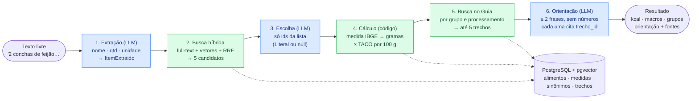

# Pipeline de uma refeição (v5)

O pipeline v5 (`v5_rag_completo`) transforma um texto livre em resultado nutricional com orientação.

**Azul:** passos em que a LLM entra, sempre com saída validada por Pydantic. **Verde:** passos determinísticos e auditáveis.

## Passo a passo

| # | Passo | Tipo | Entrada → saída | Garantia |
| --- | --- | --- | --- | --- |
| 1 | Extração | LLM | texto → lista de `ItemExtraido` (nome, quantidade, unidade) | Saída validada por Pydantic. |
| 2 | Busca híbrida | Código | nome do item → 5 candidatos | Full-text + vetores combinados por RRF. |
| 3 | Escolha | LLM | item + candidatos → id escolhido ou `null` | Só ids da lista (`Literal`); id fora da lista rejeita a resposta. |
| 4 | Cálculo | Código | id + quantidade + unidade → gramas, kcal, macros | Medida caseira IBGE → gramas; gramas × valor TACO por 100 g. |
| 5 | Busca no Guia | Código | grupos e grau de processamento → até 5 trechos | Trechos do Guia Alimentar / MS. |
| 6 | Orientação | LLM | itens + trechos → até 2 frases | Sem números; cada frase cita um `trecho_id`. |

!!! tip "Quando a medida caseira não existe"
    Se a medida caseira informada não existe na base, o item aparece como **"informe as gramas"** e **nenhum número é inventado**.

## Exemplo de resultado

!!! warning "TODO"
    Incluir um exemplo real de entrada e do JSON de `ResultadoRefeicao` retornado (campos, unidades e formato das fontes). Os documentos de origem não trazem o schema.

**Fonte:** [Estrutura do Mira](../assets/pdfs/estrutura-mira.pdf), seção 1.
