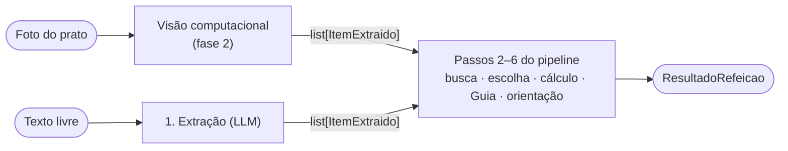

# Visão computacional (fase 2)

A análise por foto é a **fase 2** do projeto, mantida em **outro repositório** pela área de visão computacional.

## Contrato com o pipeline atual

A foto vira uma **lista de `ItemExtraido`** e, daí em diante, segue o **mesmo pipeline** do texto. **A visão não estima kcal.**

Rota prevista: `/v1/analisar-foto`.

### Tarefas da fase 2

- Dataset de pratos brasileiros com os **29 alimentos do MVP**, respeitando a LGPD.
- Baseline de detecção e estimativa de porção.

## Arquitetura de referência original

!!! info "Documento histórico"
    O diagrama abaixo vem do PDF *YOLOv8 Nutrition Analysis Pipeline* ([PDF](../assets/pdfs/pipeline-yolov8.pdf)), anterior à arquitetura atual. Ele descreve a visão completa de produto (foto + código de barras) e **não** reflete o MVP. Partes dele foram substituídas — ver a tabela de diferenças abaixo.

### O que mudou em relação à arquitetura atual

| Aspecto | Referência original (PDF) | Arquitetura atual (MVP) |
| --- | --- | --- |
| Entrada | Foto do prato + garfo; código de barras | Texto livre; foto na fase 2 |
| Endpoints | `/analisar-prato/`, `/analisar-produto/` | `/analisar-refeicao`, `/orientar`, `/recalcular`; `/v1/analisar-foto` (fase 2) |
| LLM | GPT-4o-mini / Claude (API) | Qwen 2.5 7B local via Ollama (ADR-014) |
| Quem calcula | LLM devolve JSON com calorias e macros | Código determinístico: gramas × TACO |
| Validação | Schema JSON (Structured Outputs) | Pydantic em toda saída de LLM |
| Base nutricional | Open Food Facts (produtos) | TACO + medidas caseiras IBGE; PostgreSQL + pgvector |
| Front-end | App móvel | Streamlit (MVP) |
| MLOps | Data lake, Roboflow/CVAT, Evidently/MLflow, CI/CD | DVC; CI/CD a criar |

!!! warning "TODO"
    - Definir se o fluxo de **código de barras + Open Food Facts + OCR** (RF01, RF06) continua no escopo e em qual fase.
    - Definir se as ferramentas de MLOps do diagrama original (Roboflow/CVAT, Evidently, MLflow, data lake) serão adotadas na fase 2.
    - A documentação anterior citava `qwen3:8b` como LLM; esse modelo não aparece em nenhum PDF. Confirmar que foi substituído pelo Qwen 2.5 7B (ADR-014).

**Fontes:** [YOLOv8 Nutrition Analysis Pipeline](../assets/pdfs/pipeline-yolov8.pdf); [Estrutura do Mira](../assets/pdfs/estrutura-mira.pdf), seções 3 e 6.
