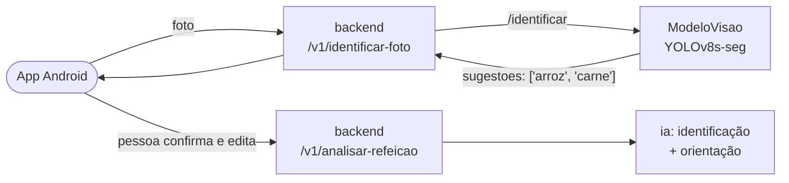
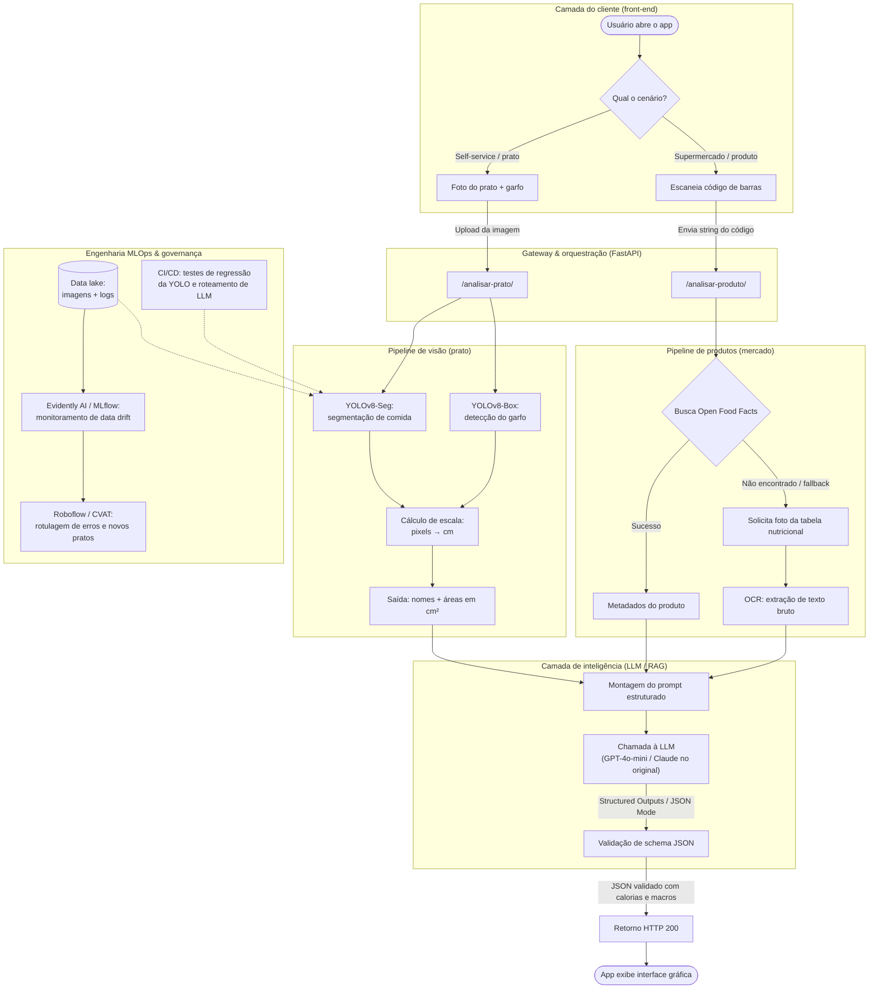

# Visão computacional

A análise por foto é a **fase 2** do projeto. A primeira versão do detector e do serviço está no repositório [`ModeloVisao`](https://github.com/residencia-ia-Challenge-2/ModeloVisao), e o `backend` já o chama a partir do app Android.

## Estado atual

| Item | Situação |
| --- | --- |
| Modelo | YOLOv8s-seg (Ultralytics 8.4.212) ajustado por 100 épocas, imagens de 640 px, treinado em 13/11/2026 |
| Classes (12) | `Arroz`, `Massa`, `Tuberculo`, `CarneV`, `CarneB`, `CarneP`, `Ovo`, `Peixe_FrutosMar`, `Grao`, `Folhas`, `Vegetais_Cru`, `Vegetais_Cozidos` |
| Métricas de validação | Caixa: mAP50 0,47, precisão 0,48, recall 0,50. Máscara: mAP50 0,46, mAP50-95 0,35 |
| Serviço | `POST /identificar` com imagem em Base64 (JPEG, PNG ou WebP, até 3 MiB). Devolve `sugestoes`: rótulos sem repetição, com confiança mínima de 0,25 |
| Integração | App Android → `backend` `POST /v1/identificar-foto` → `ModeloVisao` `/identificar` → sugestões para a pessoa conferir e editar |
| Execução | CPU, um pedido por vez (trava no serviço); imagem Docker própria |
| Licença | Ultralytics: AGPL-3.0 |

**A visão não estima kcal nem gramas.** Ela identifica categorias visuais; tipo de alimento, preparo e quantidade dependem da confirmação da pessoa e do cálculo no `backend`.

### Limites do modelo atual

| Limite | Consequência |
| --- | --- |
| Categorias grosseiras ("grão", "carne") em vez de alimentos da TACO | Cada categoria precisa ser convertida em alimentos candidatos e confirmada |
| Acurácia longe da meta (mAP50 0,46 × 85 % do RNF03) | A confirmação pela pessoa é obrigatória |
| O serviço descarta máscaras, caixas e confianças | Não dá para estimar porção nem priorizar perguntas |
| Sem classe de talher ou outro objeto de referência | O RF07 (escala pelo talher) não é possível com este modelo |
| Significado de `CarneV`, `CarneB` e `CarneP` não documentado | O serviço mostra só "carne"; a pessoa confirma qual é |
| Origem e licença do dataset (`dataset_nutrici_ia`) não documentadas | Risco de uso e de reprodução do treino |
| Sem conjunto de fotos com gabarito | Não há como comparar versões do modelo nem medir o canal de foto ponta a ponta |

A proposta para tratar esses limites com agentes (Percepção, Hipóteses e Confirmação) está em [Sistema multiagentes multimodal](multiagentes.md).

!!! warning "TODO"
    - Documentar as classes `CarneV`, `CarneB` e `CarneP`, a origem e a licença do dataset e o processo de treino.
    - Avaliar a licença AGPL-3.0 do Ultralytics para um serviço exposto em rede.
    - Medir a latência p95 do serviço.

## Arquitetura de referência original

!!! info "Documento histórico"
    O diagrama abaixo vem do PDF *YOLOv8 Nutrition Analysis Pipeline* ([PDF](../assets/pdfs/pipeline-yolov8.pdf)), anterior à arquitetura atual. Ele descreve a visão completa de produto (foto + código de barras) e **não** reflete o MVP. Partes dele foram substituídas — ver a tabela de diferenças abaixo.

### O que mudou em relação à arquitetura atual

| Aspecto | Referência original (PDF) | Arquitetura atual (MVP) |
| --- | --- | --- |
| Entrada | Foto do prato + garfo; código de barras | Texto livre; foto com sugestões de categoria confirmadas pela pessoa; código de barras no `backend` (API do Open Food Facts) |
| Visão | YOLOv8-Seg (comida) + YOLOv8-Box (garfo) → áreas em cm² | YOLOv8s-seg com 12 categorias; sem garfo nem áreas |
| Endpoints | `/analisar-prato/`, `/analisar-produto/` | `backend`: `/v1/identificar-foto`, `/v1/analisar-refeicao`, `/v1/orientar`; `ModeloVisao`: `/identificar` |
| LLM | GPT-4o-mini / Claude (API) | Qwen 2.5 7B local via Ollama (ADR-014) |
| Quem calcula | LLM devolve JSON com calorias e macros | Código determinístico: gramas × TACO |
| Validação | Schema JSON (Structured Outputs) | Pydantic em toda saída de LLM |
| Base nutricional | Open Food Facts (produtos) | TACO + medidas caseiras IBGE; PostgreSQL + pgvector |
| Front-end | App móvel | App Android (via `backend`) e Streamlit (demonstração) |
| MLOps | Data lake, Roboflow/CVAT, Evidently/MLflow, CI/CD | Dados: DVC, Airflow e CI no `mira-dados`. Visão: pesos versionados no Git, sem pipeline de treino no repositório |

!!! warning "TODO"
    - Definir se o OCR da tabela nutricional (RF06) continua no escopo como *fallback* do código de barras, e em qual fase.
    - Definir se as ferramentas de MLOps do diagrama original (Roboflow/CVAT, Evidently, MLflow, data lake) serão adotadas na fase 2.
    - A documentação anterior citava `qwen3:8b` como LLM; esse modelo não aparece em nenhum PDF. Confirmar que foi substituído pelo Qwen 2.5 7B (ADR-014).

**Fontes:** [YOLOv8 Nutrition Analysis Pipeline](../assets/pdfs/pipeline-yolov8.pdf); [Estrutura do Mira](../assets/pdfs/estrutura-mira.pdf), seções 3 e 6; `README.md`, `service/app.py` e metadados do checkpoint do [`ModeloVisao`](https://github.com/residencia-ia-Challenge-2/ModeloVisao); `src/mira_backend/app.py` do [`backend`](https://github.com/residencia-ia-Challenge-2/backend).
