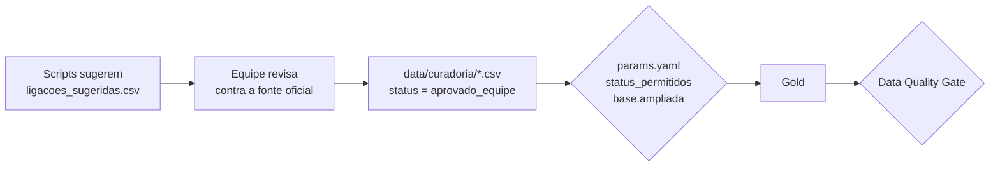

# Curadoria e rotulação

A curadoria é **decisão humana versionada no Git**, na pasta `data/curadoria/` do `mira-dados`. O ETL nunca escreve nela: os scripts só **sugerem** (por exemplo, `data/interim/ligacoes_sugeridas.csv`), e a equipe decide o que entra.

## Os 4 tipos de rotulação

| Tipo | O que rotula | Onde fica | Entra no banco? |
| --- | --- | --- | --- |
| **1. Técnica (ligação)** | TACO ↔ IBGE e sinônimos (`macaxeira` = mandioca) | `data/curadoria/nutricional/` | **Sim** (`medidas`, `sinonimos`) |
| **2. Documental oficial** | Grupo do Guia, grau de processamento, catálogo de publicações, público-alvo, regras oficiais | `data/curadoria/especialista/` | **Sim** (`grupos_guia`, `documentos`, `regras_oficiais`) |
| **3. Avaliação (gabarito)** | Refeições de teste e veredito do LLM-juiz | `eval/` no repositório **`ia`** | **Nunca** (regra fixa 4) |
| **4. Multimodal (futuro)** | Classes de foto → `alimento_id` | `data/rotulos/visao/` | Indiretamente |

## Arquivos

```text
data/curadoria/
├── nutricional/
│   ├── fontes_tabelas.csv      # manifesto: TACO, IBGE, Open Food Facts, tokenizer (URL + SHA-256)
│   ├── alimentos.csv           # 160 linhas: 29 mvp + 131 ampliacao
│   ├── ligacoes_ibge.csv       # 171 linhas: TACO ↔ (ibge_codigo, ibge_alimento, ibge_preparacao)
│   └── sinonimos.csv           # 87 linhas
└── especialista/
    ├── documentos.csv          # 19 publicações (manifesto + catálogo)
    ├── grupos_guia.csv         # 55 linhas: padrão por grupo da TACO + exceções por alimento
    ├── publico_documentos.csv  # 19 linhas: público-alvo e condição de saúde (filtro do RAG)
    └── regras_oficiais.csv     # 15 linhas: 4 recomendações, regra de ouro e Dez passos do Guia
```

## Colunas obrigatórias

`escopo`
:   `mvp` (base da Etapa 0) ou `ampliacao` (base ampliada, ADR-029). O parâmetro `base.ampliada` escolhe quais entram.

`status`
:   Estado de aprovação da linha. O parâmetro `curadoria.status_permitidos` escolhe quais status entram na Gold.

    | Valor | Significado |
    | --- | --- |
    | `proposto_agente` | Gerado por script, *fuzzy* ou LLM; ainda não revisado |
    | `a_revisar` | Pendente, com ressalva registrada em `observacao` |
    | `aprovado_equipe` | Revisado pela equipe e ancorado em fonte oficial |

`evidencia_fonte` (só em `especialista/`)
:   Capítulo, seção e página do documento oficial que sustenta a classificação. Exemplo: `guia: Capítulo 3 — Grupo dos feijões, p. 66–67`. O primeiro termo é um `documento_id` do catálogo. O Data Quality Gate reprova classificação sem evidência.

## Como a curadoria entra na base



Exemplos de uso das regras:

- **Grupo do Guia:** a linha do próprio alimento vale; sem ela, vale o padrão do grupo da TACO.
- **Grau de processamento:** só é definido por alimento. Sem classificação explícita fica nulo, nunca adivinhado.
- **Regras oficiais:** o texto de cada regra precisa aparecer literalmente no trecho citado; senão o ETL para.

## Ordem das linhas é contrato

Nos CSVs, as linhas `mvp` ficam **antes** das `ampliacao`, porque o ETL remove duplicados mantendo a primeira ocorrência. Um teste garante essa ordem, e é ela que mantém os Parquets idênticos aos do `ia`.

## Situação atual da revisão

| Arquivo | Aprovadas pela equipe | Pendentes |
| --- | ---: | ---: |
| `alimentos.csv` | 0 | 160 |
| `ligacoes_ibge.csv` | 35 | 136 |
| `sinonimos.csv` | 0 | 87 |
| `grupos_guia.csv` | 0 | 55 |
| `publico_documentos.csv` | 0 | 19 |
| `regras_oficiais.csv` | 0 | 15 |
| **Total** | **35** | **472** |

!!! warning "Perfil de produção"
    Em desenvolvimento entram os três status, para manter paridade com o `ia`. Restringir `status_permitidos` a `[aprovado_equipe]` hoje esvaziaria quase toda a curadoria: a revisão da equipe precisa vir antes dessa mudança. Nesse perfil, `publico_alvo` e `condicao_saude` ficariam nulos, e quem filtra os trechos precisa tratar `publico_alvo IS NULL` como "sem informação", não como "geral".

## Público-alvo dos trechos

`publico_alvo` e `condicao_saude` vêm de `publico_documentos.csv` e são copiados para cada linha de `trechos_ampliados`, para entrar direto no `WHERE` da busca, sem join.

| `publico_alvo` | Trechos | | `condicao_saude` | Trechos |
| --- | ---: | --- | --- | ---: |
| `geral` | 929 | | (nula) | 1.597 |
| `adultos` | 827 | | `obesidade` | 222 |
| `profissionais_saude` | 404 | | `doenca_cronica` | 220 |
| `criancas_menores_2` | 133 | | `diabetes` | 185 |
| `criancas_2_a_10` | 41 | | `hipertensao` | 133 |
| `adolescentes` | 38 | | `hospitalar` | 51 |
| `idosos` | 27 | | `cardiovascular` | 16 |
| `gestantes` | 25 | | | |

`profissionais_saude` marca manuais, políticas e instrumentos (PNAN, vigilância, marcadores, terapia hospitalar): servem para análise, mas não são orientação direta ao usuário.

O passo a passo para aprovar uma linha ou incluir um alimento está no guia [Dados e DVC](../guides/dados-dvc.md#curadoria).

**Fontes:** `data/curadoria/`, `src/mira_dados/curadoria.py` e `data/processed/relatorio_dq.json`, no repositório `data`.
