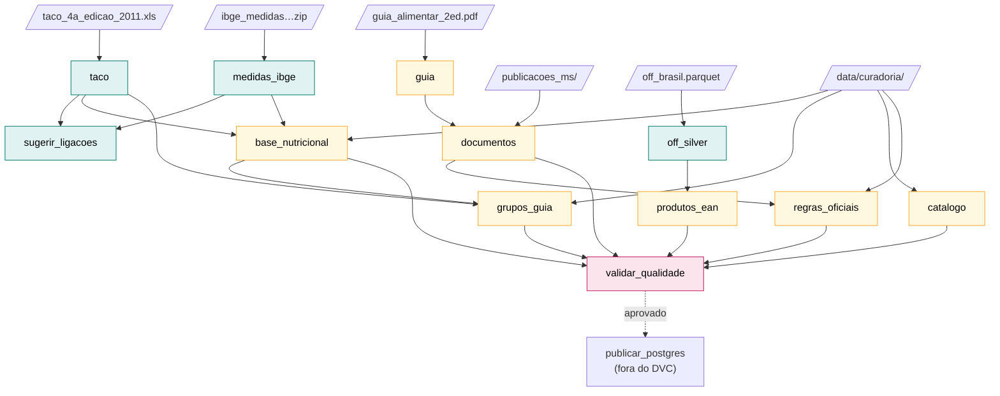
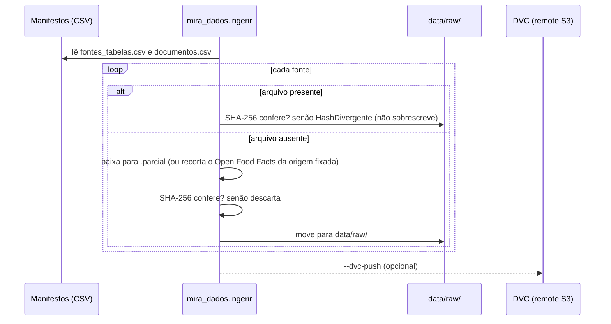
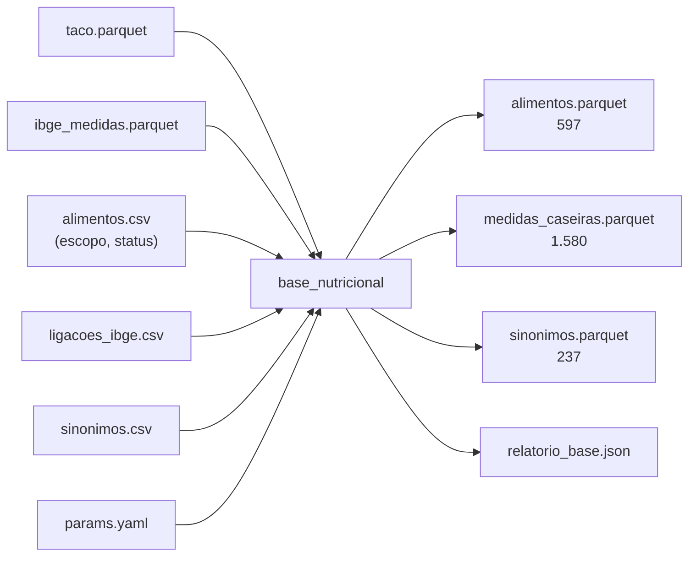

# Pipeline ETL

Toda regra de extração, limpeza e montagem da base fica em `src/mira_dados/` e pode ser testada com `pytest`, sem Airflow. O `dvc.yaml` encadeia os estágios até a Gold e o Data Quality Gate. A publicação no banco é um passo separado, porque depende de PostgreSQL e Ollama (veja [Publicação e orquestração](publicacao.md)).

## Grafo do `dvc repro`



## Estágios

| Estágio | Módulo | Entrada → saída | Camada |
| --- | --- | --- | --- |
| `taco` | `silver.taco` | `.xls` → `interim/taco.parquet` | Silver |
| `medidas_ibge` | `silver.medidas` | `.zip` → `interim/ibge_medidas.parquet` | Silver |
| `sugerir_ligacoes` | `silver.ligacoes` | TACO × IBGE → `interim/ligacoes_sugeridas.csv` (insumo de revisão humana) | Silver |
| `off_silver` | `silver.off` | `off_brasil.parquet` → `interim/off_produtos.parquet` | Silver |
| `base_nutricional` | `gold.base_nutricional` | Silver + curadoria nutricional → `alimentos`, `medidas_caseiras`, `sinonimos` | Gold |
| `grupos_guia` | `gold.grupos_guia` | Alimentos + curadoria especialista → `grupos_guia.parquet` | Gold |
| `guia` | `gold.guia` | PDF do Guia → `guia_trechos.parquet` | Gold |
| `documentos` | `gold.documentos` | 18 PDFs do MS + Guia → `documentos_trechos.parquet` | Gold |
| `catalogo` | `gold.catalogo` | Catálogo + público e condição de saúde → `documentos_catalogo.parquet` | Gold |
| `regras_oficiais` | `gold.regras_oficiais` | Curadoria + trechos → `regras_oficiais.parquet` | Gold |
| `produtos_ean` | `gold.produtos_ean` | Silver do Open Food Facts → `produtos_ean.parquet` + `relatorio_off.json` | Gold |
| `validar_qualidade` | `qualidade --estrito` | Tudo → `relatorio_dq.json` (se reprovar, o `dvc repro` para) | Data Quality |

## Bronze: ingestão

O Bronze é **imutável**: nenhum arquivo de `data/raw/` é editado, e toda limpeza acontece depois.



```bash
python -m mira_dados.ingerir              # baixa o que faltar e confere os hashes
python -m mira_dados.ingerir --verificar  # só confere; falha se faltar arquivo
dvc pull data/raw/*.dvc                   # alternativa: puxa do remote S3
```

Os binários nunca vão para o Git, só os arquivos `.dvc`. O recorte do Open Food Facts é gerado por `python -m mira_dados.ingerir_off` (veja [Fontes de dados](fontes.md#open-food-facts-em-detalhe)).

## Silver: limpeza e padronização

A Silver traduz cada fonte para um formato tabular limpo, **sem decidir nada que seja da curadoria**.

### TACO

| Problema da fonte | Tratamento |
| --- | --- |
| Cabeçalho de 3 linhas repetido a cada página | Linhas sem `taco_id` numérico são descartadas; o layout é conferido antes |
| Linha com o nome do grupo antes dos itens | Vira a coluna `grupo` |
| `Tr` (traço) | `0.0`, com marcador `Tr` |
| `NA`, `*` ou vazio | `NULL`, com marcador (nunca zero) |
| Carboidrato entre −0,5 e 0 | `0.0`, com marcador `negativo`; abaixo de −0,5 o contrato rejeita |
| Sanidade | 597 alimentos, ids 1 a 597 e 15 grupos; senão o estágio falha |

### IBGE

- Lê `tabelamedidas_bd.xls` de dentro do zip (aba `Tab_Medidas Caseiras`, cabeçalho na linha 4) e confere as colunas pelo nome.
- Normaliza as medidas com `unidades.normalizar_unidade` (`Colheres de Sopa` → `colher de sopa`).
- Usa a chave composta `(ibge_codigo, ibge_alimento, ibge_preparacao, medida)`, porque o mesmo código aparece com nomes diferentes (o 8570328 é "ARROZ COM FEIJÃO" e também "PAO COM MANTEIGA").

### Ligações sugeridas

*Fuzzy matching* (`rapidfuzz.token_set_ratio`) gera os 5 alimentos do IBGE mais parecidos com cada alimento da TACO e sugere a preparação (`cozido` → `CROZIDO(A)`). É **só sugestão**: a ligação que vale é a aprovada em `data/curadoria/nutricional/ligacoes_ibge.csv`.

### Open Food Facts

Um produto por linha, com valores por 100 g extraídos de `nutriments` via DuckDB. Cada produto recebe a lista `dq_motivos` (bloqueantes) e `dq_alertas`. Nada é corrigido: só os produtos sem nenhum motivo bloqueante chegam à Gold.

| Motivo bloqueante | Regra | Produtos rejeitados |
| --- | --- | ---: |
| `sem_dados_nutricionais` | kcal, proteína, carboidrato e lipídios todos nulos | 8.780 |
| `atwater_divergente` | \|kcal − (4P + 4C + 9L)\| maior que máx(25 %, 10 kcal); em bebida alcoólica vira só alerta | 2.701 |
| `gtin_invalido` | Não é GTIN-8/12/13/14 com dígito verificador válido | 435 |
| `fora_da_faixa` | kcal fora de [0, 900] ou nutriente fora de [0, 100] g/100 g | 168 |
| `soma_macros` | P + C + L > 105 g/100 g | 166 |
| `sodio_implausivel` | Sódio > 40 g/100 g | 88 |
| `kj_como_kcal` | kcal/Atwater entre 3,9 e 4,5, ou kcal igual a kJ | 50 |
| `porcao_como_100g` | Valor "por 100 g" idêntico ao "por porção", com porção diferente de 100 g | 0 |
| `gtin_duplicado` | Mesmo GTIN repetido (fica o editado por último) | 0 |
| `obsoleto` | Marcado como obsoleto no Open Food Facts | 0 |

Um produto pode ter mais de um motivo. Alertas que não bloqueiam: `tabela_por_porcao`, `valores_por_100ml` (bebidas), `sem_kcal`, `sem_nome` e `sem_nova`.

## Gold: base de serving

A Gold junta a Silver com a curadoria humana e produz exatamente o que vai para o banco.

### Base nutricional



1. **Alimentos:** com `base.ampliada: true`, entra a TACO inteira; com `false`, só os alimentos do MVP e os distratores da mesma família.
2. **Medidas:** só para alimentos com ligação aprovada; a ligação de menor `prioridade` vence em cada medida; `g` e `kg` ficam de fora porque a conversão é feita em código.
3. **Sinônimos:** os da curadoria mais os nomes do IBGE das ligações, sem repetição de termo normalizado.
4. **Erros que param o ETL:** ligação para chave do IBGE inexistente, alimento curado que não está na TACO e sinônimo órfão.

### Grupos do Guia

A classificação do próprio alimento vale; sem ela, vale o padrão do grupo da TACO. O grau de processamento **só** é definido por alimento: nos demais fica nulo ("não classificado"), nunca adivinhado. Resultado: 518 de 597 alimentos têm grupo do Guia e 42 têm grau de processamento.

### Trechos documentais

- **Guia:** a tipografia do PDF (fontes Gotham) define capítulos e seções, das pp. 11 a 129. São 147 trechos no corte por palavras (`guia_001` a `guia_147`) e mais 1 do corte por tokens (`guia_148`).
- **18 publicações:** regras relativas a cada documento. O corpo é o tamanho de fonte com mais caracteres; título tem 1,15 × o corpo ou mais; capítulo, 1,5 × ou mais.
- **Regra comum:** um trecho nunca cruza seção; cada trecho tem cerca de 160 a 265 palavras; sobras pequenas se juntam ao trecho anterior.

### Corte por tokens reais

O modelo de embeddings `granite-embedding:278m` tem janela de **512 tokens**, e o Ollama corta o excesso em silêncio. Com o corte só por palavras, 30 de 2.394 textos passavam desse limite.

Por isso, depois do corte por palavras, todo trecho cujo **texto indexado** (título do documento + capítulo + seção + texto) passa de `chunking.max_tokens` é dividido com o tokenizer do próprio modelo, guardado no Bronze:

- As partes são **equilibradas** e cortadas em fronteira de parágrafo ou de frase; só se uma frase sozinha não couber o corte é por palavra.
- A 1ª parte **mantém o `trecho_id`**. As demais recebem os números seguintes ao último do documento (`cab36_0177`, …). Nenhum id existente muda.
- As partes herdam capítulo, seção e intervalo de páginas do trecho original.

Resultado com `max_tokens: 512`: 30 trechos cortados, de 2.394 para **2.424**, e nenhum acima de 512 tokens. Com `chunking.max_tokens: null`, o corte volta a ser só por palavras (paridade com a base antiga do `ia`).

!!! warning "O corte por tokens mudou o hash da base"
    Com o corte ligado, `guia_trechos` e `documentos_trechos` ganharam 30 partes e o `base_sha256` mudou. O `ia` precisa dos Parquets novos (`dvc pull`) para o `RepositorioPostgres(verificar_base=True)` aceitar o banco publicado.

### Catálogo e regras oficiais

- **`documentos_catalogo.parquet`:** o catálogo das 19 publicações com `publico_alvo` e `condicao_saude` (vocabulário controlado), vindos de `publico_documentos.csv`. Os dois campos ficam nulos se a linha da curadoria não tiver status admitido.
- **`regras_oficiais.parquet`:** as 4 recomendações do capítulo 2, a regra de ouro e os Dez passos do Guia (15 regras), cada uma ligada ao `trecho_id` de onde foi transcrita. Se o texto não for encontrado **literalmente** no trecho, o ETL para.

### Produtos EAN

Só os produtos sem motivo bloqueante: **26.389 de 38.425 (68,7 %)**, com `produto_id = ean_<gtin>` e `fonte_revisao` igual ao commit da origem. O `relatorio_off.json` traz a contagem por motivo e a cobertura de cada campo.

## Texto indexado

O texto que vira embedding é montado por `texto.py`, com a mesma lógica do `ia`:

| Tabela | Texto indexado |
| --- | --- |
| `alimentos` | Nome, grupo, preparo e sinônimos. **Nenhum número nutricional** (regra fixa 3). |
| `trechos` (legado) | Capítulo, seção e texto |
| `trechos_ampliados` | Título do documento, capítulo, seção e texto |

## Parâmetros (`params.yaml`)

| Chave | Valor atual | Efeito |
| --- | --- | --- |
| `base.ampliada` | `true` | `true`: escopo `mvp` + `ampliacao` e a TACO inteira; `false`: base da Etapa 0 |
| `base.incluir_distratores` | `true` | Inclui alimentos da mesma família na TACO (ADR-007) |
| `curadoria.status_permitidos` | os 3 status | Quais status de curadoria entram na Gold (em produção: só `aprovado_equipe`) |
| `off.tolerancia_atwater` | `0.25` | Tolerância entre kcal e `4P + 4C + 9L` |
| `off.tolerancia_atwater_kcal_min` | `10` | Piso absoluto, em kcal, para produtos de baixa energia |
| `off.max_soma_macros_g` | `105` | Soma máxima de macronutrientes por 100 g |
| `embeddings.modelo` / `dimensao` | `granite-embedding:278m` / `768` | Modelo usado na publicação e dimensão da coluna `vector` |
| `embeddings.janela_tokens` | `512` | Janela do modelo; `chunking.max_tokens` não pode passar dela |
| `chunking.max_tokens` | `512` | Teto de tokens reais por texto indexado; `null` desliga o corte |
| `chunking.tokenizer` | `granite_embedding_278m_tokenizer.json` | Tokenizer do modelo, em `data/raw/` |

Mudar um parâmetro invalida só os estágios que dependem dele: o DVC sabe disso pelo `dvc.lock`.

## Invariância com o `ia`

O ETL foi portado linha a linha do `ia`, com as mesmas versões de pandas, pyarrow e PyMuPDF. Com `chunking.max_tokens: null`, o `dvc repro` gera Parquets **byte a byte idênticos** aos do `ia`, tanto com `base.ampliada: false` quanto com `true`. A prova é o script `scripts/comparar_invariancia.py`.

**Fontes:** `dvc.yaml`, `params.yaml`, `src/mira_dados/silver/` e `src/mira_dados/gold/`, no repositório `data`.
