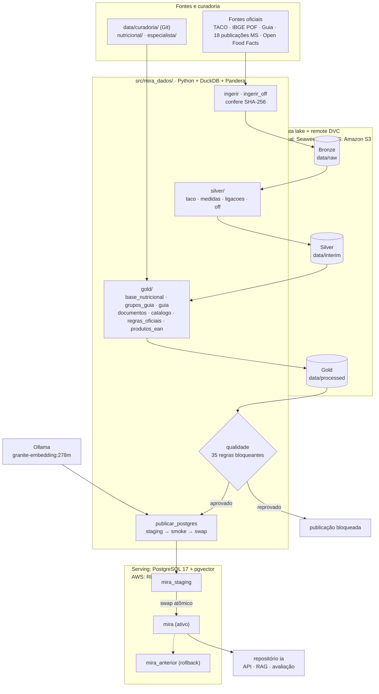

# Arquitetura de dados

A base de dados do Mira é construída pelo repositório [`data`](https://github.com/residencia-ia-Challenge-2/data) (pacote `mira-dados`). Esse repositório cuida de todo o ciclo de vida dos dados: baixa as fontes oficiais, limpa e padroniza, junta com a curadoria humana, valida a qualidade e publica o resultado no PostgreSQL. O repositório `ia` **só lê** o schema publicado.

Esta seção explica como os dados são produzidos. Para consultar as tabelas e colunas do banco, veja [Banco de dados e fontes](../reference/dados.md). Para regenerar a base passo a passo, veja o guia [Dados e DVC](../guides/dados-dvc.md).

## Visão geral

A arquitetura segue o padrão **medalhão** (Bronze → Silver → Gold). A curadoria humana entra na Gold, um Data Quality Gate bloqueia a publicação se alguma regra falhar, e o banco troca de versão numa operação atômica.

## Camadas

| Camada | Pasta | O que contém | Regra principal |
| --- | --- | --- | --- |
| **Bronze** | `data/raw/` | Arquivos originais das fontes (XLS, ZIP, PDF, Parquet) | Imutável. Nada é editado; cada arquivo é conferido por SHA-256. |
| **Silver** | `data/interim/` | Cada fonte em formato tabular limpo e padronizado | Limpa, mas **não decide** nada que seja da curadoria. |
| **Gold** | `data/processed/` | A base de serving: alimentos, medidas, sinônimos, grupos, trechos, regras e produtos | Junta Silver e curadoria; é exatamente o que vai para o banco. |
| **Curadoria** | `data/curadoria/` | Decisões humanas em CSV, versionadas no Git | Scripts só sugerem; quem aprova é a equipe. |

As pastas `data/interim/` e `data/processed/` nunca são editadas à mão: são sempre regeneradas pelo `dvc repro`. Detalhes de cada camada em [Pipeline ETL](etl.md).

## Fronteira entre repositórios

| Repositório | É dono de | Não contém |
| --- | --- | --- |
| **`data`** (`mira-dados`) | Fontes brutas, ETL, curadoria, Data Quality, DDL (Alembic), embeddings em lote, publicação no banco | API, prompts de LLM, pipelines RAG, gabarito de avaliação |
| **`ia`** | Pipelines RAG (`v1` a `v5`), LLM, avaliação (`eval/`), API FastAPI, Streamlit | DDL, carga destrutiva, download ou parsing de fontes |

A separação vale nos dois sentidos: o `ia` só lê o banco, e o `mira-dados` nunca lê o gabarito de avaliação.

## Princípios

1. **Lógica fora do orquestrador.** Toda regra fica em `src/mira_dados/` e roda com `python -m`. O DVC e o Airflow só encadeiam os mesmos comandos.
2. **Reprodutibilidade.** Bronze conferido por hash (DVC + SHA-256 nos manifestos), parâmetros em `params.yaml` e linhagem em `dvc.lock`.
3. **Falhar cedo e alto.** Contratos em cada camada e um Data Quality Gate bloqueante. Uma publicação recusada é um erro explícito (`PublicacaoRecusada`), nunca uma carga parcial.
4. **Serving sem indisponibilidade.** Carga em staging, *smoke test*, troca de schema numa transação e rollback com um comando.
5. **Humano decide, máquina sugere.** *Fuzzy matching* e agentes só propõem (`proposto_agente`). A aprovação é da equipe, ancorada em fonte oficial.

## Regras fixas dos dados

Cada regra tem uma verificação automática. Nenhuma depende só de disciplina. Mudar qualquer uma delas exige um ADR.

| # | Regra | Como é garantida |
| --- | --- | --- |
| 1 | **Nenhum número vem de LLM.** A composição nutricional vem só de fontes oficiais ou curadas e de cálculo determinístico (`gramas × valor por 100 g`). | Nenhum módulo do ETL chama LLM. No Open Food Facts, kcal ausente não é recalculada. |
| 2 | **Nulo nunca vira zero.** Na TACO, `Tr` vira `0.0`; `NA`, `*` e vazio viram `NULL`. | `silver/taco.py::converter_valor` + regra `nulo_nunca_vira_zero` do Data Quality Gate. |
| 3 | **Texto indexado sem números.** O texto vetorizado de um alimento tem só nome, grupo, preparo e sinônimos. | `texto.py::texto_indexado` + regra `texto_indexado_sem_numeros_nutricionais`. |
| 4 | **Avaliação separada da base.** O gabarito (`eval/` do `ia`) nunca entra no banco nem vira regra. | Regra `avaliacao_fora_da_base` + teste dedicado. |
| 5 | **LGPD.** Nenhum dado identificável é versionado ou registrado em log. | Recorte do Open Food Facts por lista de permissão de colunas + regra `lgpd_off_sem_contribuidores`. |

!!! note "Sem nutricionista na equipe"
    Nenhuma regra clínica é inventada. Toda classificação qualitativa aponta para capítulo, seção e página do Guia Alimentar ou de uma publicação do Ministério da Saúde (coluna `evidencia_fonte`). Veja [Curadoria](curadoria.md).

## A base hoje

Números de `data/processed/relatorio_dq.json` (Data Quality Gate aprovado, 35 regras bloqueantes e 7 alertas; schema Alembic `0002`).

| Item | Volume | Fonte |
| --- | ---: | --- |
| Alimentos (nutrientes por 100 g) | 597 | TACO 4ª ed. |
| Alimentos com medida caseira | 160 (26,8 %) | IBGE POF 2008-2009 |
| Medidas caseiras → gramas | 1.580 | IBGE POF 2008-2009 |
| Sinônimos | 237 | Curadoria + nomes do IBGE |
| Alimentos com grupo do Guia | 518 | Curadoria do Guia |
| Alimentos com grau de processamento | 42 | Curadoria do Guia |
| Trechos do Guia Alimentar | 148 | Guia Alimentar 2ª ed. |
| Trechos documentais | 2.424 (todos com no máximo 512 tokens) | Guia + 18 publicações do MS |
| Regras oficiais | 15 | 4 recomendações, regra de ouro e Dez passos do Guia |
| Produtos com código de barras | 26.389 | Open Food Facts (recorte Brasil) |

## Nesta seção

| Página | Conteúdo |
| --- | --- |
| [Fontes de dados](fontes.md) | Inventário, licenças, manifestos, particularidades de cada fonte e protocolo de admissão. |
| [Registro de datasets](registro-datasets.md) | Histórico de aumento da base e registro de admissão de cada fonte. |
| [Pipeline ETL](etl.md) | Bronze, Silver e Gold: o que cada estágio faz, grafo do DVC e parâmetros. |
| [Data Quality e contratos](qualidade.md) | Contratos Pydantic e Pandera, regras bloqueantes, alertas e garantias do relatório. |
| [Curadoria e rotulação](curadoria.md) | Tipos de rotulação, arquivos, status de aprovação e situação da revisão. |
| [Modelo de dados](modelo-dados.md) | DER, tabelas, índices, vocabulários controlados e `metadados`. |
| [Publicação e orquestração](publicacao.md) | Carga atômica no PostgreSQL, migrações Alembic e DAG do Airflow. |
| [Infraestrutura](infraestrutura.md) | Stack local e AWS, docker-compose, remote DVC, CI e Terraform. |
| [Estrutura do repositório](repositorio.md) | Pastas do repositório `data` e o que vai para o Git. |
| [Integração com o `ia`](integracao-ia.md) | Contrato entre os repositórios e provas de compatibilidade. |
| [Contrato para RAG e agentes](rag-agentes.md) | Prontidão, filtros de público e consultas SQL prontas para cada agente. |
| [Decisões de engenharia](decisoes.md) | Decisões D01 a D31 e pendências de decisão. |
| [Roadmap e status](roadmap.md) | Fases concluídas, próximos passos e pendências de dados. |

Os comandos para regenerar e publicar a base estão no guia [Dados e DVC](../guides/dados-dvc.md).

**Fontes:** `README.md`, `dvc.yaml`, `src/mira_dados/` e `data/processed/relatorio_dq.json`, no repositório `data`; [Blueprint de dados](../sobre/blueprint-dados.md), seções 1 a 3.
