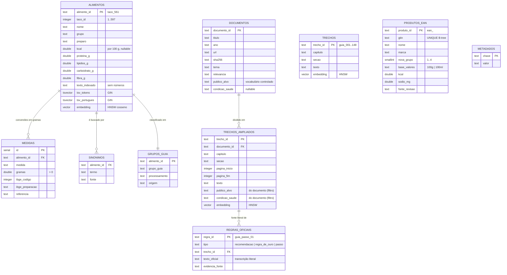

# Modelo de dados

Schema `mira` no PostgreSQL 17 com `pgvector`, criado pelas migrações Alembic `0001_schema_inicial` e `0002_filtros_rag_regras_trgm`. A `0002` acrescenta os filtros do RAG, a tabela `regras_oficiais` e o `pg_trgm`. Todas as colunas que o repositório `ia` lê são mantidas exatamente como ele espera.

## Diagrama entidade-relacionamento

## Tabelas

| Tabela | Linhas | Índices | Observação |
| --- | ---: | --- | --- |
| `alimentos` | 597 | PK, 2 × GIN, HNSW, trigramas em `nome` | Nutrientes por 100 g; nulo significa sem dado na fonte |
| `medidas` | 1.580 | PK, `alimento_id` | `id serial` preserva a ordem da base |
| `sinonimos` | 237 | `alimento_id`, trigramas em `termo` | Curadoria + nomes do IBGE das ligações |
| `grupos_guia` | 597 | PK | `processamento` com CHECK nas 4 categorias do Guia |
| `documentos` | 19 | PK | Catálogo das publicações, com público-alvo e condição de saúde |
| `trechos_ampliados` | 2.424 | PK, 2 × GIN, HNSW, `documento_id`, `publico_alvo`, `condicao_saude` | Guia + 18 publicações, com `tema`, `relevancia`, `publico_alvo` e `condicao_saude` do documento |
| `trechos` | 148 | PK, 2 × GIN, HNSW | **Legado:** só o Guia, lido pela `v5_rag_completo` do `ia` |
| `regras_oficiais` | 15 | PK, FK para `trechos_ampliados` e `documentos` | Recomendações, regra de ouro e Dez passos do Guia |
| `produtos_ean` | 26.389 | PK, UNIQUE em `gtin` | Open Food Facts (ODbL); leitura por código de barras |
| `metadados` | — | PK | Veja abaixo |

!!! note "Por que `trechos` é uma tabela e não uma view"
    O texto vetorizado de `trechos` é `capítulo. seção. texto`; o de `trechos_ampliados` começa pelo título do documento. Uma view sobre `trechos_ampliados` mudaria os vetores que o `ia` usa, por isso as duas são tabelas reais.

!!! note "`exigido_mvp` não vai para o banco"
    A coluna existe no Parquet de alimentos, mas o DDL do `ia` não tem essa coluna, e ela nasce do conjunto de avaliação (regra fixa 4). Por isso fica só na Gold.

## Vocabulários controlados

| Coluna | Valores |
| --- | --- |
| `grupos_guia.processamento` | `in_natura_ou_minimamente_processado`, `ingrediente_culinario`, `processado`, `ultraprocessado` (ou nulo, "não classificado") |
| `grupos_guia.origem` | `alimento` (classificação própria) ou `grupo_taco` (padrão do grupo) |
| `regras_oficiais.tipo` | `recomendacao`, `regra_de_ouro`, `passo` |
| `documentos.publico_alvo` | `geral`, `adultos`, `profissionais_saude`, `criancas_menores_2`, `criancas_2_a_10`, `adolescentes`, `idosos`, `gestantes` |
| `documentos.condicao_saude` | `obesidade`, `doenca_cronica`, `diabetes`, `hipertensao`, `hospitalar`, `cardiovascular` (ou nulo) |
| `produtos_ean.base_valores` | `100g` ou `100ml` (bebidas) |

## `metadados`

| Chave | Conteúdo |
| --- | --- |
| `base_sha256` | Hash dos 6 Parquets da base, com **o mesmo algoritmo do `hash_base()` do `ia`** |
| `produtos_ean_sha256` | Hash do Parquet de produtos EAN |
| `complementos_sha256` | Hash do catálogo e das regras oficiais (fora do `base_sha256` do `ia`) |
| `relatorio_dq_sha256` | Hash do relatório do Data Quality Gate usado na carga |
| `dq_aprovado` | `true` (a publicação é recusada sem DQ aprovado) |
| `modelo_embeddings`, `dimensao` | `granite-embedding:278m`, `768` |
| `versao_schema` | Revisão Alembic (`0002`) |
| `chunking_max_tokens` | Teto do corte por tokens usado na carga (`512` ou `desligado`) |
| `carregado_em` | Data e hora da carga |
| `smoke_ok` | `true` só depois do smoke test; o swap exige esse valor |

## Busca

| Item | Valor |
| --- | --- |
| Modelo de embeddings | `granite-embedding:278m` (Ollama), o mesmo no `mira-dados` e no `ia` |
| Dimensão | 768 (parametrizável por migração para experimentos, por exemplo 1024) |
| Full-text | `tsv_tokens` (configuração `simple`) e `tsv_portugues` (`portuguese` + `unaccent`), ambos GIN |
| Vetorial | HNSW com `vector_cosine_ops` |
| Trigramas | `pg_trgm` em `alimentos.nome` e `sinonimos.termo` (autocomplete sem LLM) |

Consultas prontas para cada uso estão em [Contrato para RAG e agentes](rag-agentes.md).

**Fontes:** `alembic/versions/0001_schema_inicial.py` e `0002_filtros_rag_regras_trgm.py`, `src/mira_dados/publicar_postgres.py` e `data/processed/relatorio_dq.json`, no repositório `data`.
