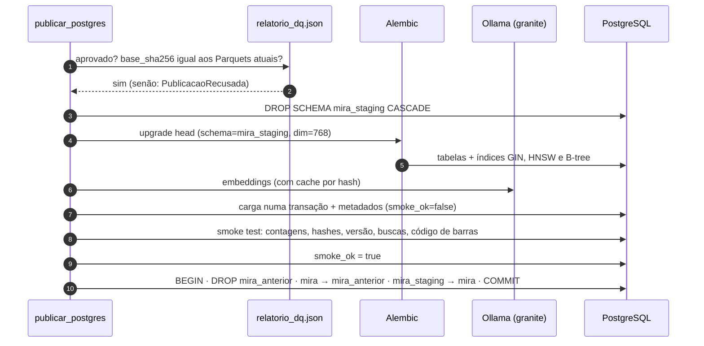
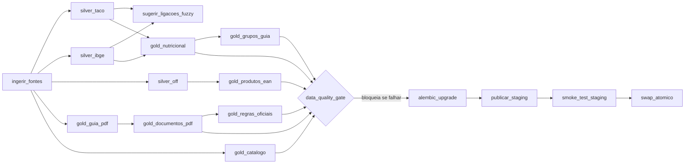

# Publicação e orquestração

Depois que o Data Quality Gate aprova a Gold, `python -m mira_dados.publicar_postgres` carrega a base num schema de staging, testa e só então troca o schema ativo, numa operação atômica. O schema `mira`, que o `ia` lê, nunca fica vazio nem pela metade.

## Publicação atômica



### Schemas

| Schema | Papel |
| --- | --- |
| `mira` | Ativo, lido pelo `ia` |
| `mira_staging` | Recebe a carga nova; recriado do zero a cada publicação |
| `mira_anterior` | Versão anterior, guardada para rollback |
| `mira_exp_<nome>` | Experimentos (outro modelo de embeddings, outro corte); **nunca** viram produção |

Só esses nomes são aceitos, para proteger o SQL dinâmico contra injeção (o DDL não aceita parâmetro no nome do schema).

### Fases

```bash
python -m mira_dados.publicar_postgres --fase <fase> [--schema mira_exp_<nome>]
```

| Fase | O que faz | Recusa quando |
| --- | --- | --- |
| `migrar` | Recria só o `mira_staging` vazio pela migração Alembic | — |
| `staging` | Recria `mira_staging` e carrega tudo numa transação | DQ reprovado, Parquets alterados depois do DQ, carga direta em `mira` ou `mira_anterior`, dimensão de vetor errada |
| `smoke` | Roda 17 verificações e marca `smoke_ok` | — (registra o resultado) |
| `swap` | Troca os schemas numa transação, com *advisory lock* | `smoke_ok` diferente de `true`, staging inexistente ou de outra base |
| `rollback` | Troca `mira` ↔ `mira_anterior` numa transação (rodar de novo desfaz) | Falta um dos dois schemas |
| `status` | Mostra os metadados de `mira`, `mira_staging` e `mira_anterior` | — |
| `all` | `staging` → `smoke` → `swap`; **para** se o smoke reprovar | Idem |

### Smoke test

| Grupo | Verificações |
| --- | --- |
| Contagens | Todas as tabelas com exatamente as linhas da Gold |
| Rastreabilidade | `base_sha256`, `dq_aprovado`, `versao_schema` (igual à `alembic_version`) e `modelo_embeddings` |
| Conteúdo | Todo alimento com vetor e sem número nutricional no texto |
| Busca híbrida | "feijao carioca cozido" → `taco_561` no top 3; "arroz tipo 1 cozido" → `taco_3`; "Grupo dos feijões" → trecho da seção certa |
| Código de barras | Leitura por `gtin` no índice B-tree |

Na primeira publicação real com `granite-embedding:278m`, as 17 verificações passaram e a carga levou 12,6 s.

### Garantias testadas

`tests/test_publicar_postgres.py` roda contra um banco descartável (`MIRA_DADOS_TEST_DATABASE_URL`) e cobre:

- o ciclo completo staging → smoke → swap → rollback → rollback;
- smoke reprovado **preserva** o schema ativo: carga incompleta, smoke falha, swap recusado, `mira` intacto;
- swap sem smoke é recusado, e `--fase all` para no smoke reprovado;
- DQ reprovado e Parquets alterados depois do DQ bloqueiam o staging;
- experimento em `mira_exp_*` não toca no `mira`, e nomes de schema maliciosos são recusados.

## Migrações (Alembic)

Todo o DDL, inclusive os índices GIN e HNSW, fica nas migrações. A carga só insere dados.

| Revisão | Conteúdo |
| --- | --- |
| `0001_schema_inicial` | Tabelas lidas pelo `ia` (incluindo a legada `trechos`), `produtos_ean`, `metadados`, extensões `vector` e `unaccent`, índices GIN, HNSW e B-tree |
| `0002_filtros_rag_regras_trgm` | `publico_alvo`, `condicao_saude`, `tema` e `relevancia` nos trechos; tabela `regras_oficiais`; `pg_trgm` com índices em `alimentos.nome` e `sinonimos.termo` |

```bash
alembic upgrade head                                          # schema mira
alembic -x schema=mira_staging upgrade head                   # schema alvo parametrizável
alembic -x schema=mira_exp_bgem3 -x embedding_dim=1024 upgrade head
```

Cada schema guarda a **própria** tabela `alembic_version`, então a versão do DDL viaja junto no swap.

## Orquestração (Airflow)

A DAG `mira_ciclo_dados` (`orchestration/dags/mira_ciclo_dados.py`) **só orquestra**: cada task chama um comando `python -m mira_dados.*`, o mesmo do terminal, do `dvc repro` e dos testes. Um teste garante que a DAG não importa `mira_dados` nem bibliotecas de dados.



| Task | Comando (`python -m …`) | Retries |
| --- | --- | --- |
| `ingerir_fontes` | `mira_dados.ingerir` | 3, com *backoff* exponencial a partir de 30 s (máx. 10 min) |
| `silver_taco` · `silver_ibge` · `silver_off` | `silver.taco` · `silver.medidas` · `silver.off` | 0 (erro de schema não se resolve repetindo) |
| `sugerir_ligacoes_fuzzy` | `silver.ligacoes` | 0; **não bloqueia** a publicação |
| `gold_nutricional` · `gold_grupos_guia` | `gold.base_nutricional` · `gold.grupos_guia` | 0 |
| `gold_guia_pdf` · `gold_documentos_pdf` | `gold.guia` · `gold.documentos` | 0 |
| `gold_catalogo` · `gold_regras_oficiais` | `gold.catalogo` · `gold.regras_oficiais` | 0 |
| `gold_produtos_ean` | `gold.produtos_ean` | 0 |
| `data_quality_gate` | `qualidade --estrito` | 0; se falhar, nada depois dele roda |
| `alembic_upgrade` | `publicar_postgres --fase migrar` | 0 |
| `publicar_staging` | `publicar_postgres --fase staging` | 1 (recria o staging do zero, então é seguro repetir) |
| `smoke_test_staging` | `publicar_postgres --fase smoke` | 0 |
| `swap_atomico` | `publicar_postgres --fase swap` | 0 |

São 17 tasks. Configuração: `schedule=None` (disparo manual ou por nova versão de fonte ou curadoria), `catchup=False` e `max_active_runs=1`, para que duas publicações nunca concorram.

!!! note "Por que `alembic_upgrade` usa `--fase migrar`"
    Um `alembic upgrade head` direto no schema `mira`, na primeira execução, criaria um `mira` vazio, que o swap depois guardaria como `mira_anterior`. A fase `migrar` só recria o `mira_staging`, sem tocar no schema ativo.

```bash
make up-airflow                                                    # build + sobe o Airflow
docker compose exec airflow-scheduler airflow dags trigger mira_ciclo_dados
make test-dag                                                      # DagBag com o Airflow real
```

**Ambiente:** a imagem `orchestration/Dockerfile` usa `apache/airflow:3.3.2-python3.12` com um venv separado (`/opt/mira-venv`) para o ETL, instalado de `requirements.lock`. Assim o Airflow fica com as versões dele de SQLAlchemy e Alembic, e o ETL com as versões validadas. O repositório é montado em `/opt/mira-dados`.

**Na AWS (MWAA):** troca-se o `BashOperator` por `EcsRunTaskOperator`, com a imagem do ECR e os mesmos comandos. Nenhuma regra muda, porque elas não estão na DAG.

## Como o `ia` confere a base

O `ia` lê a tabela `mira.metadados` para saber se o banco corresponde à base que ele espera:

| Chave | Conteúdo |
| --- | --- |
| `base_sha256` | Hash dos 6 Parquets da base, com o mesmo algoritmo do `hash_base()` do `ia` |
| `produtos_ean_sha256` · `complementos_sha256` · `relatorio_dq_sha256` | Hashes dos produtos, do catálogo e regras, e do relatório de DQ usado na carga |
| `dq_aprovado` | Sempre `true` (sem DQ aprovado não há publicação) |
| `versao_schema` | Revisão Alembic (hoje `0002`) |
| `modelo_embeddings` · `dimensao` | `granite-embedding:278m` e `768` |
| `chunking_max_tokens` | Teto do corte por tokens usado na carga |
| `carregado_em` · `smoke_ok` | Data da carga e resultado do smoke test |

A compatibilidade foi provada com o código do `ia` **sem alteração**: os testes de integração `test_v4_banco.py`, `test_v5_orientacao.py` e `test_documentos.py` passaram (24 de 24) contra o PostgreSQL do `mira-dados`.

**Fontes:** documentação do `mira-dados`: [Publicação no PostgreSQL](https://github.com/residencia-ia-Challenge-2/data/blob/main/docs/pipelines/publicacao.md), [Orquestração](https://github.com/residencia-ia-Challenge-2/data/blob/main/docs/pipelines/orquestracao.md), [Modelo de dados](https://github.com/residencia-ia-Challenge-2/data/blob/main/docs/definicao/modelo_dados.md) e [Integração com o `ia`](https://github.com/residencia-ia-Challenge-2/data/blob/main/docs/arquitetura/integracao_ia.md); `orchestration/dags/mira_ciclo_dados.py`.
