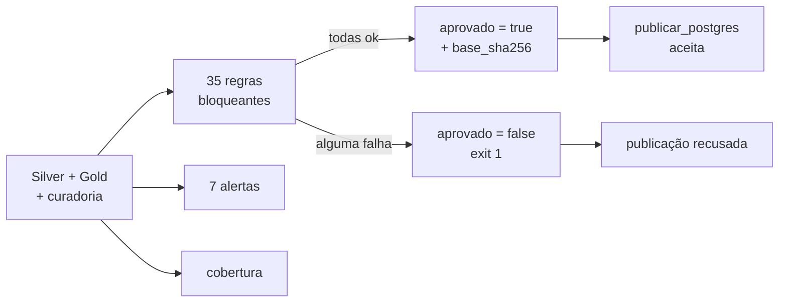

# Data Quality e contratos

A qualidade dos dados é verificada em dois níveis: **contratos** em cada camada, que barram registros malformados, e o **Data Quality Gate**, que valida a base inteira antes de qualquer publicação.

## Contratos de dados

Os dois tipos de contrato ficam em `src/mira_dados/contratos.py`.

- **Pydantic v2 (registro a registro):** valida cada linha no momento em que o ETL a cria. Os modelos são cópias exatas dos do `ia`, e a ordem dos campos define a ordem das colunas nos Parquets.
- **Pandera (tabela inteira):** valida tipos, faixas, unicidade e regras entre colunas. É usado pelo Data Quality Gate.

### Pydantic

| Modelo | Usado em | Regras principais |
| --- | --- | --- |
| `LinhaTaco` | Silver TACO | `taco_id` de 1 a 597; nutrientes entre 0 e 100 (kcal até 900); nulos permitidos |
| `LinhaMedida` | Silver IBGE | `ibge_codigo` de 7 dígitos; `gramas` > 0 e até 10.000 |
| `Alimento`, `Nutrientes`, `MedidaCaseira`, `Sinonimo` | Gold nutricional | `alimento_id` no formato `taco_<n>`; `gramas` > 0 |
| `TrechoGuia`, `TrechoDocumento` | Gold documental | `trecho_id` no formato `<doc>_<nnn>`; páginas ≥ 1 |
| `GrupoGuia`, `Processamento` | Gold especialista | As 4 categorias de processamento do Guia |

### Pandera

| Schema | Camada | Regras além do tipo |
| --- | --- | --- |
| `TacoSilverSchema` | Silver | `taco_id` único de 1 a 597; faixas físicas |
| `IbgeSilverSchema` | Silver | Chave única `(ibge_codigo, ibge_alimento, ibge_preparacao, medida)` |
| `OffSilverSchema` | Silver | Só a forma; faixas viram motivo de rejeição, não erro de schema |
| `AlimentoGoldSchema` | Gold | `alimento_id` único; faixas físicas |
| `MedidaGoldSchema` | Gold | `(alimento_id, medida)` único; sem `g` ou `kg` |
| `SinonimoGoldSchema` | Gold | `(alimento_id, termo_normalizado)` único |
| `GrupoGuiaGoldSchema` | Gold | Uma linha por alimento; `processamento` e `origem` em vocabulário fechado |
| `TrechoSchema`, `TrechoDocumentoSchema` | Gold | `trecho_id` único; `pagina_inicio ≤ pagina_fim` |
| `DocumentoCatalogoSchema` | Gold | Público e condição de saúde no vocabulário controlado |
| `RegraOficialSchema` | Gold | `regra_id` único; `tipo` em recomendação, regra de ouro ou passo; `trecho_id` no formato do `ia`; páginas ≥ 1 |
| `ProdutoEanGoldSchema` | Gold | GTIN e `produto_id` únicos; faixas; soma de macros ≤ 105 g |

!!! tip "Por que o Open Food Facts não quebra o pipeline"
    Na Silver, um produto ruim é registrado **com o motivo** (`dq_motivos`) em vez de derrubar o estágio; só a Gold exige as faixas físicas. Assim o relatório mostra quantos produtos caíram em cada regra.

## Data Quality Gate

`python -m mira_dados.qualidade --estrito` valida Silver, Gold e curadoria e grava `data/processed/relatorio_dq.json`. Se **qualquer** regra bloqueante falhar, o comando sai com código 1: o `dvc repro` e a DAG do Airflow param antes de chegar ao banco.

### Regras bloqueantes (35)

=== "Contratos (11)"

    | Regra | Schema |
    | --- | --- |
    | `contrato_taco_silver` | `TacoSilverSchema` |
    | `contrato_ibge_silver` | `IbgeSilverSchema` |
    | `contrato_alimentos` | `AlimentoGoldSchema` |
    | `contrato_medidas` | `MedidaGoldSchema` |
    | `contrato_sinonimos` | `SinonimoGoldSchema` |
    | `contrato_grupos_guia` | `GrupoGuiaGoldSchema` |
    | `contrato_trechos_guia` | `TrechoSchema` |
    | `contrato_trechos_documentos` | `TrechoDocumentoSchema` |
    | `contrato_documentos_catalogo` | `DocumentoCatalogoSchema` |
    | `contrato_regras_oficiais` | `RegraOficialSchema` |
    | `contrato_produtos_ean` | `ProdutoEanGoldSchema` |

=== "Integridade (10)"

    | Regra | Verifica |
    | --- | --- |
    | `fk_medidas_alimentos` | Toda medida aponta para um alimento existente |
    | `fk_sinonimos_alimentos` | Todo sinônimo aponta para um alimento existente |
    | `grupos_guia_cobre_alimentos` | Exatamente uma classificação por alimento |
    | `fk_trechos_documentos` | Todo trecho pertence a um documento do catálogo |
    | `documentos_todos_com_trechos` | Todo documento do catálogo gerou trechos |
    | `guia_contido_na_base_ampliada` | Todos os trechos do Guia estão na base ampliada |
    | `taco_contem_alimentos_gold` | Todo alimento da Gold existe na TACO |
    | `catalogo_gold_igual_curadoria` | O catálogo da Gold tem os mesmos documentos, na mesma ordem |
    | `fk_regras_trechos` | Toda regra oficial aponta para um trecho existente |
    | `fk_regras_documentos` | Toda regra oficial pertence a um documento do catálogo |

=== "Conferências (8)"

    | Regra | Verifica |
    | --- | --- |
    | `taco_597_alimentos_15_grupos` | Estrutura da TACO |
    | `ibge_chave_composta_unica` | Chave `(código, nome, preparação, medida)` única |
    | `guia_147_trechos_originais` | `guia_001` a `guia_147` estáveis; partes do corte por tokens só depois |
    | `19_documentos` | Catálogo completo |
    | `sanidade_taco` | Valores de referência: arroz ≈ 128 kcal, feijão ≈ 76, frango ≈ 159, leite integral nulo |
    | `nulo_nunca_vira_zero` | Marcador `NA`, `*` ou vazio nunca tem valor (regra fixa 2) |
    | `texto_indexado_sem_numeros_nutricionais` | Dígitos só no nome da TACO (regra fixa 3) |
    | `trechos_dentro_da_janela_embedding` | Nenhum texto indexado acima de `chunking.max_tokens` |

=== "Governança (6)"

    | Regra | Verifica |
    | --- | --- |
    | `curadoria_rotulos_validos` | `escopo` e `status` válidos em todos os CSVs |
    | `especialista_com_evidencia_oficial` | Classificação sem `evidencia_fonte` reprova |
    | `publico_documentos_com_evidencia` | Todo documento tem público definido, com evidência do próprio documento |
    | `regras_oficiais_literais_na_fonte` | O texto da regra está, literalmente, no trecho citado |
    | `avaliacao_fora_da_base` | Nenhum `eval/` ou `queries*.jsonl` no repositório (regra fixa 4) |
    | `lgpd_off_sem_contribuidores` | Nenhum campo de contribuidor no Bronze do Open Food Facts (regra fixa 5) |

### Alertas atuais (7)

Alertas não bloqueiam a publicação, mas apontam trabalho pendente.

| Alerta | Valor | Ação |
| --- | ---: | --- |
| `curadoria_pendente_alimentos` | 160 | Revisão da equipe |
| `curadoria_pendente_ligacoes_ibge` | 136 | Revisão da equipe |
| `curadoria_pendente_sinonimos` | 87 | Revisão da equipe |
| `curadoria_pendente_grupos_guia` | 55 | Revisão da equipe |
| `curadoria_pendente_publico_documentos` | 19 | Revisão da equipe |
| `curadoria_pendente_regras_oficiais` | 15 | Revisão da equipe |
| `produtos_ean_sem_nova` | 19.757 de 26.389 | Não inferir; avaliar uma regra documentada |

### Garantias do relatório

- **Determinístico:** o relatório não tem data nem hora, então o mesmo dado gera sempre o mesmo arquivo (testado).
- **Amarrado aos dados:** `base_sha256`, `complementos_sha256` e `produtos_ean_sha256` identificam os Parquets validados. A publicação se recusa a carregar se os Parquets mudaram depois do DQ.
- **Testado contra defeitos:** `tests/test_qualidade.py` corrompe cópias da base (medida órfã, kcal negativa, número no sinônimo, trecho duplicado, nulo virando zero) e confere que cada defeito reprova.

### Os hashes da base

| Hash | Cobre | Quem usa |
| --- | --- | --- |
| `base_sha256` | Os 6 Parquets que o `ia` confere: `alimentos`, `documentos_trechos`, `grupos_guia`, `guia_trechos`, `medidas_caseiras`, `sinonimos` | `hash_base()` do `ia`, com o mesmo algoritmo |
| `complementos_sha256` | `documentos_catalogo` e `regras_oficiais`, que só o `mira-dados` produz | Publicação |
| `produtos_ean_sha256` | `produtos_ean` | Publicação |

**Fontes:** `src/mira_dados/contratos.py`, `src/mira_dados/qualidade.py`, `tests/test_qualidade.py` e `data/processed/relatorio_dq.json`, no repositório `data`.
