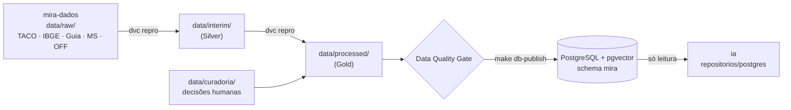

# Estrutura do repositório

O código do Mira fica em dois repositórios: o [`ia`](https://github.com/residencia-ia-Challenge-2/ia) (aplicação, pipelines e avaliação) e o [`data`](https://github.com/residencia-ia-Challenge-2/data) (`mira-dados`, ciclo de vida dos dados). A fronteira entre eles está em [Escopo](../produto/escopo.md#repositorios).

## Repositório `ia`

| Pasta | Conteúdo | Área responsável |
| --- | --- | --- |
| `src/mira/dominio/` | Modelos Pydantic e unidades: o "idioma comum" do projeto | Todos (mudança via PR revisado) |
| `src/mira/nutricao/` | Cálculo determinístico, testado com valores conhecidos da TACO | Ciência de dados |
| `src/mira/rag/`, `repositorios/` | Busca (BM25, embeddings, RRF) e leitura da base (local, LangChain, PostgreSQL) | Ciência (busca) + Eng. de dados (banco) |
| `src/mira/llm/` | Cliente de LLM (Ollama/Anthropic/falso) e prompts versionados | Ciência de dados |
| `src/mira/pipelines/` | Uma implementação por etapa (`v1_baseline` … `v5_rag_completo`) | Ciência de dados |
| `src/mira/api/`, `app/` | FastAPI e interface Streamlit | Desenvolvimento |
| `eval/` | Conjunto anotado (`queries.jsonl`), avaliador comum (`run_eval.py`), juiz da orientação, resultados em JSON | Ciência de dados |
| `tests/` | Testes sem rede, com LLM falsa | Todos; CI/CD executa |
| `docker-compose.yml`, `.github/` | PostgreSQL + pgvector; pipeline de CI e deploy (**a criar**) | CI/CD |
| `docs/` | `DESENVOLVIMENTO.md` (diário, ADRs, métricas), revisões e entrega | Quem fecha a etapa |
| `data/`, `src/mira/dados/` | **Legado:** cópia do ETL antigo e dos Parquets, usada para conferir o `base_sha256`. O ETL passou para o `mira-dados` | Eng. de dados |

## Repositório `data` (`mira-dados`)

| Pasta | Conteúdo | Área responsável |
| --- | --- | --- |
| `data/raw/` + `FONTES.md` | Bronze: TACO, IBGE POF, Guia, 18 publicações do MS, Open Food Facts, tokenizer do embedding (DVC) | Eng. de dados |
| `data/curadoria/nutricional/` | Manifesto das fontes, alimentos, ligações TACO↔IBGE, sinônimos | Eng. de dados + Ciência |
| `data/curadoria/especialista/` | Catálogo de publicações, grupos do Guia, público dos documentos, regras oficiais | Eng. de dados + Ciência |
| `data/interim/`, `data/processed/` | Silver e Gold, gerados por `dvc repro`. **Nunca se editam à mão** | Eng. de dados |
| `src/mira_dados/` | Ingestão, ETL (`silver/`, `gold/`), Data Quality e publicação no PostgreSQL | Eng. de dados |
| `alembic/` | Migrações do schema `mira` (`0001`, `0002`) | Eng. de dados |
| `orchestration/` | DAG `mira_ciclo_dados` do Airflow | Eng. de dados |
| `infra/terraform/` | Esqueleto AWS (S3, RDS, ECR) | Eng. de dados + CI/CD |
| `docker-compose.yml`, `Makefile`, `.github/` | PostgreSQL + pgvector, SeaweedFS (S3 local), Airflow; CI | Eng. de dados |
| `docs/` | Documentação própria (MkDocs): definição, pipelines, arquitetura, operação | Eng. de dados |

*Fora dos dois repositórios:* visão computacional (fase 2): dataset de fotos, modelo e estimativa de porção.

## Fluxo dos dados

A curadoria entra no estágio Gold (`base_nutricional`, `grupos_guia`, `catalogo`, `regras_oficiais`). Ver [Dados e DVC](../guides/dados-dvc.md).

**Fontes:** [Estrutura do Mira](../assets/pdfs/estrutura-mira.pdf), seções 2 e 3; [Estrutura do repositório `data`](../dados/repositorio.md).
