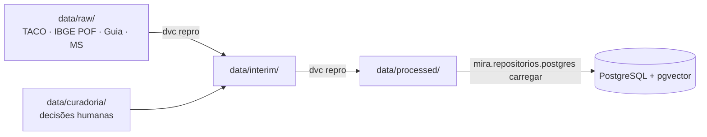

# Estrutura do repositório

Pastas do repositório de código e a área responsável por cada uma.

| Pasta | Conteúdo | Área responsável |
| --- | --- | --- |
| `data/raw/` + `FONTES.md` | TACO, IBGE POF, Guia Alimentar e publicações do MS (versionados com DVC) | Eng. de dados |
| `data/curadoria/` | Decisões humanas no Git: alimentos do MVP, ligações TACO↔IBGE, sinônimos, grupos do Guia | Eng. de dados + Ciência |
| `data/interim/`, `data/processed/` | Gerados por `dvc repro`. **Nunca se editam à mão** | Eng. de dados |
| `src/mira/dados/` | ETL: `taco.py`, `medidas.py`, `guia.py`, `documentos.py`, `carregar.py` | Eng. de dados |
| `src/mira/dominio/` | Modelos Pydantic e unidades: o "idioma comum" do projeto | Todos (mudança via PR revisado) |
| `src/mira/nutricao/` | Cálculo determinístico, testado com valores conhecidos da TACO | Ciência de dados |
| `src/mira/rag/`, `repositorios/` | Busca (BM25, embeddings, RRF) e acesso à base (local, LangChain, PostgreSQL) | Ciência (busca) + Eng. de dados (banco) |
| `src/mira/llm/` | Cliente de LLM (Ollama/Anthropic/falso) e prompts versionados | Ciência de dados |
| `src/mira/pipelines/` | Uma implementação por etapa (`v1_baseline` … `v5_rag_completo`) | Ciência de dados |
| `src/mira/api/`, `app/` | FastAPI e interface Streamlit | Desenvolvimento |
| `eval/` | Conjunto anotado (`queries.jsonl`), avaliador comum (`run_eval.py`), juiz da orientação, resultados em JSON | Ciência de dados |
| `tests/` | 94 testes, sem rede, com LLM falsa | Todos; CI/CD executa |
| `docker-compose.yml`, `.github/` | PostgreSQL + pgvector; pipeline de CI e deploy (**a criar**) | CI/CD |
| `docs/` | `DESENVOLVIMENTO.md` (diário, ADRs, métricas), revisões e entrega | Quem fecha a etapa |
| *fora do repositório* | Visão computacional (fase 2): dataset de fotos, modelo e estimativa de porção | Visão computacional |

## Fluxo dos dados

!!! warning "TODO"
    Confirmar em que estágio do `dvc.yaml` os arquivos de `data/curadoria/` entram no fluxo (o diagrama acima assume a etapa intermediária).

**Fonte:** [Estrutura do Mira](../assets/pdfs/estrutura-mira.pdf), seções 2 e 3.
