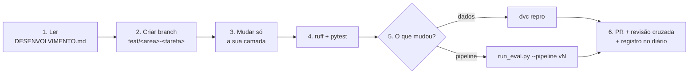

# Como contribuir sem quebrar a comparação

## Fluxo



1. Ler `docs/DESENVOLVIMENTO.md` no repositório de código (etapa atual, ADRs, questões em aberto).
2. Criar a branch:

    ```bash
    git checkout -b feat/<area>-<tarefa>
    ```

3. Mudar **só a sua camada**. Mudanças em `dominio/` ou `nutricao/` afetam todas as etapas e exigem [ADR](../architecture/decisoes.md).
4. Rodar lint e testes (sem rede, LLM falsa):

    ```bash
    ruff check . && pytest
    ```

5. Validar conforme o que mudou:

    === "Mexeu em dados"

        ```bash
        dvc repro
        ```

    === "Mexeu em pipeline"

        ```bash
        python eval/run_eval.py --pipeline vN
        ```

6. Abrir o PR, pedir **revisão cruzada** e registrar a decisão no diário.

## Revisão cruzada

| Autor | Revisor |
| --- | --- |
| Dados | Ciência |
| Ciência | Dados |
| Desenvolvimento | Visão |
| Visão | Desenvolvimento |

## Fechar uma etapa

Quem fecha uma etapa atualiza `DESENVOLVIMENTO.md` (seção, métricas, ADRs, questões) e cria a tag `etapa-N`.

!!! warning "TODO"
    Definir convenção de mensagens de commit, template de PR e regras de proteção da `main` (a Estrutura prevê `main` protegida como tarefa de CI/CD).

**Fonte:** [Estrutura do Mira](../assets/pdfs/estrutura-mira.pdf), seções 6 e 7.
