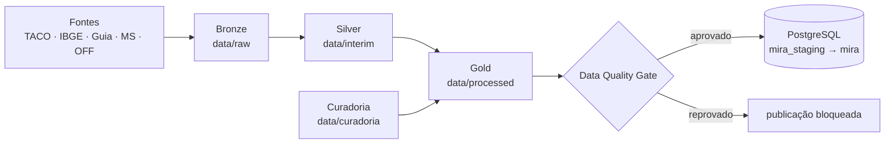

# Dados e DVC

Mudanças em fontes, ETL, curadoria ou carga do banco são feitas no repositório [`data`](https://github.com/residencia-ia-Challenge-2/data) (`mira-dados`), não no `ia`. Este guia resume o fluxo; a explicação de cada camada está na seção [Dados](../dados/index.md), e os comandos completos estão no [Guia rápido do `mira-dados`](https://github.com/residencia-ia-Challenge-2/data/blob/main/docs/operacao/guia_rapido.md).

!!! info "Transição"
    O `ia` ainda guarda uma cópia do ETL antigo (`src/mira/dados/`) e dos Parquets em `data/processed/`, que ele usa para conferir o `base_sha256`. A fonte da verdade é o `mira-dados`: não altere o ETL no `ia`.

## Camadas

| Camada | Pasta | Gerada por | Regra |
| --- | --- | --- | --- |
| Bronze | `data/raw/` | `python -m mira_dados.ingerir` ou `dvc pull` | Fontes originais, versionadas com DVC; manifestos com SHA-256 |
| Silver | `data/interim/` | `dvc repro` | Limpeza e padronização (TACO, IBGE, Open Food Facts) |
| Gold | `data/processed/` | `dvc repro` | Base de serving: alimentos, medidas, sinônimos, grupos, trechos, produtos |
| Curadoria | `data/curadoria/` | Pessoas, no Git | Decisões humanas: ligações TACO↔IBGE, sinônimos, grupos do Guia, catálogo de publicações |

`data/interim/` e `data/processed/` **nunca se editam à mão**. Os scripts só **sugerem** curadoria (ex.: `data/interim/ligacoes_sugeridas.csv`); quem decide é a equipe.



## Regenerar os dados

```bash
# no repositório mira-dados
python3 -m venv .venv && .venv/bin/pip install -e ".[dev]"
cp .env.example .env
make up                 # PostgreSQL (porta 5433) + S3 local (SeaweedFS)
dvc pull data/raw/*.dvc # baixa o Bronze do remote S3
dvc repro               # Silver → Gold → Data Quality Gate (para se reprovar)
make db-publish         # staging → smoke → swap no PostgreSQL (Ollama ligado)
make db-status
```

O remote do DVC é `s3://mira-dados/dvc`: SeaweedFS em desenvolvimento, Amazon S3 em produção. As credenciais ficam só em `.dvc/config.local`, nunca no Git. Sem acesso ao remote, `python -m mira_dados.ingerir` baixa as fontes das URLs originais e confere o SHA-256 de cada uma.

O Airflow (`make up-airflow`) roda o mesmo ciclo pela DAG `mira_ciclo_dados`.

## Estágios do `dvc.yaml`

| Estágio | Saída | Camada |
| --- | --- | --- |
| `taco`, `medidas_ibge` | `taco.parquet`, `ibge_medidas.parquet` | Silver |
| `sugerir_ligacoes` | `ligacoes_sugeridas.csv` (insumo de revisão humana) | Silver |
| `off_silver` | `off_produtos.parquet` | Silver |
| `base_nutricional` | alimentos, medidas e sinônimos (Silver + curadoria nutricional) | Gold |
| `grupos_guia` | `grupos_guia.parquet` (alimentos + curadoria do Guia) | Gold |
| `guia`, `documentos` | trechos do Guia e das publicações do MS | Gold |
| `catalogo`, `regras_oficiais` | catálogo de publicações e regras oficiais do Guia | Gold |
| `produtos_ean` | produtos do Open Food Facts + `relatorio_off.json` | Gold |
| `validar_qualidade` | `relatorio_dq.json` (falha = `dvc repro` para) | Data Quality |

A curadoria entra na **Gold**, não na Silver. A publicação no banco fica fora do DVC porque depende de PostgreSQL e Ollama.

## Curadoria

Cada linha de curadoria tem um `status`:

| Status | Significado |
| --- | --- |
| `proposto_agente` | Gerado por script, *fuzzy* ou LLM; ainda não revisado |
| `a_revisar` | Pendente, com ressalva em `observacao` |
| `aprovado_equipe` | Revisado pela equipe e ancorado em fonte oficial |

Em desenvolvimento entram os três status. Em produção, só `aprovado_equipe` deve entrar, mas hoje isso esvaziaria quase toda a curadoria.

??? example "Aprovar uma linha de curadoria"
    1. Revise a linha em `data/curadoria/...` contra a fonte oficial.
    2. Troque `status` para `aprovado_equipe`. Em `especialista/`, confira a coluna `evidencia_fonte` (capítulo, seção e página).
    3. Rode `dvc repro` (o Data Quality Gate revalida) e publique com `make db-publish`.

??? example "Adicionar um alimento ou uma medida caseira"
    1. Alimento: inclua a linha em `data/curadoria/nutricional/alimentos.csv` com `escopo` (`mvp` ou `ampliacao`) e `status`. As linhas `mvp` ficam **antes** das `ampliacao`: a ordem é contrato testado.
    2. Medida: ligue o alimento da TACO ao nome do IBGE em `ligacoes_ibge.csv` (use `ligacoes_sugeridas.csv` como ponto de partida).
    3. Sinônimo: inclua em `sinonimos.csv`.
    4. Rode `dvc repro`, `ruff check . && pytest` e publique.

## LGPD

Nenhuma refeição real de usuário é versionada. Do Open Food Facts entram só as colunas de uma lista de permissão, sem dados de contribuidores.

## Pendências de dados

| Pendência | Impacto |
| --- | --- |
| Revisão da curadoria pela equipe (472 linhas pendentes) | Bloqueia o perfil de produção (`aprovado_equipe`) |
| Cobertura de medidas caseiras em 26,8 % dos alimentos | Itens sem gramas para o usuário |
| Grupo NOVA em só 25 % dos produtos do Open Food Facts | Orientação sobre ultraprocessados incompleta |
| `ia` lendo tudo do PostgreSQL, em vez de conferir os Parquets do disco | Acoplamento entre os repositórios |
| CI do `mira-dados` executando no GitHub | O workflow só foi validado localmente |
| TBCA, OCR de rótulo, imagens | Features futuras |

**Fontes:** documentação do `mira-dados`: [Pipelines](https://github.com/residencia-ia-Challenge-2/data/blob/main/docs/pipelines/index.md), [Curadoria](https://github.com/residencia-ia-Challenge-2/data/blob/main/docs/definicao/curadoria.md), [Guia rápido](https://github.com/residencia-ia-Challenge-2/data/blob/main/docs/operacao/guia_rapido.md) e [Roadmap](https://github.com/residencia-ia-Challenge-2/data/blob/main/docs/operacao/roadmap.md).
