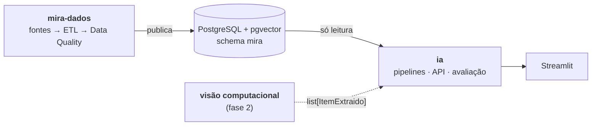

# Escopo

O que o projeto entrega agora, o que fica para depois e o que não faz parte dele. Os requisitos que cada item atende estão em [Requisitos](requisitos.md); a situação de cada um no MVP está na [rastreabilidade](requisitos.md#rastreabilidade-com-o-mvp).

## Dentro do escopo: MVP (texto livre)

| Entrega | Situação | Onde |
| --- | --- | --- |
| Entrada da refeição em **texto livre** ("2 conchas de feijão e 1 filé de frango") | Implementado | `ia` |
| Extração de itens e escolha do alimento pela LLM, **só entre candidatos da base** | Implementado | `ia` |
| Cálculo determinístico de gramas, kcal e macros (`gramas × valor por 100 g`) | Implementado | `ia` |
| Orientação qualitativa baseada no Guia Alimentar e em publicações do MS | Implementado | `ia` |
| Base de serving: TACO, medidas caseiras do IBGE, sinônimos, grupos do Guia e trechos documentais | Publicada | `mira-dados` |
| Etapas comparáveis (v1 a v5) avaliadas no mesmo conjunto | Etapas 0 a 6 concluídas; Etapa 7 pendente | `ia` |
| Interface de demonstração (Streamlit) e API (FastAPI) | Implementado | `ia` |
| API pública para o app Android, com o cálculo autoritativo dos nutrientes | Implementado | `backend` |
| Leitura de **código de barras** (`/v1/produtos/{codigo}`) | Implementado, consultando ao vivo a API pública do Open Food Facts. A tabela `produtos_ean` do `mira-dados` (26.389 produtos com checagem de qualidade) ainda não é usada | `backend` |

## Fase 2

| Entrega | Situação | Onde |
| --- | --- | --- |
| Análise por **foto do prato** (segmentação, estimativa de porção) | Primeira versão: YOLOv8s-seg com 12 categorias, servido em `POST /identificar` e chamado pelo `backend` (`/v1/identificar-foto`); devolve só sugestões de categoria, sem porção | [`ModeloVisao`](https://github.com/residencia-ia-Challenge-2/ModeloVisao) |
| Filtro por público e condição de saúde na busca de trechos | Dados prontos; código não | `mira-dados` (dados) · `ia` (busca) |

## Futuro (sem fase definida)

- OCR da tabela nutricional como *fallback* do código de barras (RF06).
- TBCA para alimentos fora da TACO (depende dos termos de uso).
- Histórico de refeições por data e tipo (RF05).
- App móvel com fluxo de 3 toques (RNF02); o MVP usa Streamlit.
- Deploy em nuvem (AWS: S3, RDS, ECR e MWAA); hoje tudo roda em instâncias locais.
- Multiagentes para texto e foto sobre a base do `mira-dados` (ver [proposta](../architecture/multiagentes.md)).

## Fora do escopo

- **A LLM gerar números nutricionais.** Calorias e macros vêm só da base, por cálculo em código (ver [Regras fixas](../architecture/decisoes.md)).
- **Regras clínicas próprias.** Sem nutricionista no time, toda classificação qualitativa aponta para o Guia Alimentar ou uma publicação do MS.
- **Prescrição de dieta ou diagnóstico.** O Mira orienta sobre a qualidade do prato; não substitui um profissional de saúde.
- **Versionar refeições reais de usuários** (LGPD).

## Repositórios

O projeto é dividido em repositórios com donos e fronteiras claras.

| Repositório | É dono de | Não contém |
| --- | --- | --- |
| [`documentacao`](https://github.com/residencia-ia-Challenge-2/documentacao) (este site) | Produto, arquitetura geral, guias e referência | Código |
| [`ia`](https://github.com/residencia-ia-Challenge-2/ia) | Pipelines RAG (v1 a v5), LLM e prompts, avaliação (`eval/`), API FastAPI e Streamlit | DDL do banco, carga destrutiva, download de fontes |
| [`data`](https://github.com/residencia-ia-Challenge-2/data) (`mira-dados`) | Fontes brutas, ETL, curadoria, Data Quality, migrações do banco e publicação | API, prompts, pipelines RAG, gabarito de avaliação |
| [`ModeloVisao`](https://github.com/residencia-ia-Challenge-2/ModeloVisao) | Pesos do detector e serviço de identificação por foto (`POST /identificar`) | Cálculo, porções e nutrientes |
| [`backend`](https://github.com/residencia-ia-Challenge-2/backend) | API pública `/v1/*` para o app Android; chama o `ia` e o `ModeloVisao` | — |

A separação vale nos dois sentidos: o `ia` **só lê** o banco, e o `mira-dados` **nunca** lê o gabarito de avaliação. Detalhes em [Banco de dados e fontes](../reference/dados.md).

!!! warning "TODO"
    Decidir se o código de barras passa a consultar a tabela `produtos_ean` antes da API ao vivo do Open Food Facts (ver [proposta multiagentes](../architecture/multiagentes.md#fluxo-do-codigo-de-barras)).

**Fontes:** [Estrutura do Mira](../assets/pdfs/estrutura-mira.pdf), seções 1, 2 e 6; [Arquitetura de dados](../dados/index.md#regras-fixas-dos-dados) e [Roadmap dos dados](../dados/roadmap.md).
