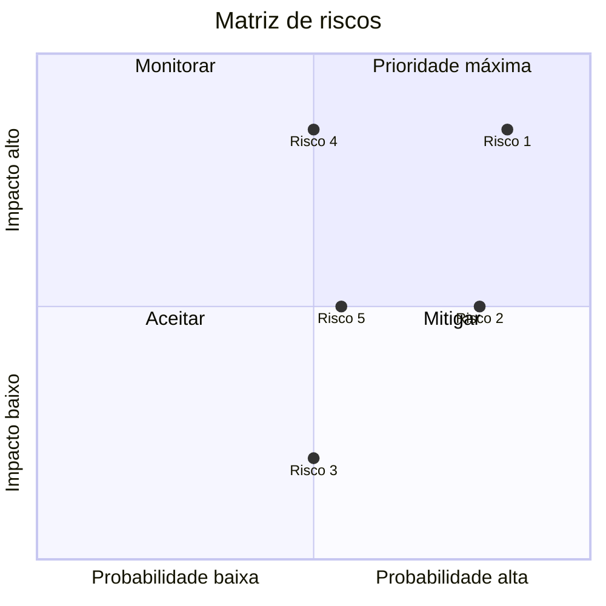

# Riscos e premissas

## Riscos e mitigações

| ID | Risco | Probabilidade | Impacto | Mitigação |
| --- | --- | --- | --- | --- |
| Risco 1 | Imprecisão na estimativa de volume e peso a partir de imagens 2D. | Alta | Alto | Objeto de referência visual (talher ou garfo) para escala pixel→cm e ajuste rápido por fração de prato. |
| Risco 2 | Dificuldade de identificar ingredientes não visíveis (óleos, manteiga, temperos). | Alta | Médio | Formulário pós-captura simples, rápido e opcional para indicar métodos de preparo comuns. |
| Risco 3 | Falha na leitura ou ausência do item na base de código de barras. | Média | Baixo | Módulo de *fallback* com OCR da tabela nutricional da embalagem. |
| Risco 4 | *Data drift* / degradação da acurácia do YOLOv8-Seg por variações nas fotos enviadas. | Média | Alto | Monitoramento contínuo com Evidently AI e retreinamento automatizado com CVAT e MLflow. |
| Risco 5 | Inconsistência no formato dos dados de saída da LLM. | Média | Médio | Validação estrita do schema com Structured Outputs / JSON Mode. |

!!! info "Risco 5 na implementação atual"
    No MVP, toda saída de LLM passa por validação **Pydantic** antes de ser usada, e a escolha de alimento só aceita ids da lista de candidatos (`Literal` ou `null`). Ver [Pipeline de uma refeição](../architecture/pipeline-refeicao.md).

!!! note "Mudou na v2"
    Coluna **Probabilidade** adicionada; **Riscos 4 e 5** são novos.

## Premissas

| ID | Premissa |
| --- | --- |
| P01 | Os usuários utilizam smartphones com câmera funcional e têm conexão contínua à internet durante o uso. |
| P02 | O estado da arte da visão computacional (YOLOv8) e de modelos multimodais permite segmentar múltiplos alimentos com latência aceitável para aplicações móveis. |
| P03 | O uso integrado de tabelas nutricionais consolidadas (TACO, TBCA e Open Food Facts) assegura a validade e a precisão dos dados exibidos. |

!!! note "Mudou na v2"
    Em **P03**, a v1 citava **USDA**; a v2 substituiu por **Open Food Facts**.

!!! warning "TODO"
    A implementação atual usa **TACO + medidas caseiras do IBGE (POF)**, e a TBCA ainda está em avaliação (termos de uso). Atualizar P03 com as bases efetivamente usadas.

**Fontes:** [Definições do Projeto v2](../assets/pdfs/definicoes-projeto-v2.pdf), seções 6 e 7.
