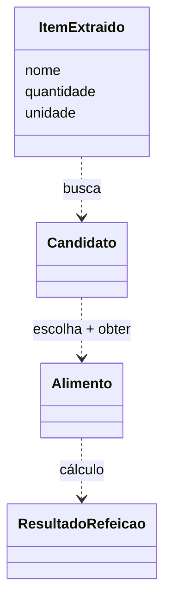

# Contratos e modelos

Os dois contratos que sustentam a arquitetura em camadas:

```python
class Pipeline(Protocol):
    nome: str
    def analisar(self, texto: str) -> ResultadoRefeicao: ...

class RepositorioAlimentos(Protocol):
    def buscar(self, consulta: str, k: int = 3) -> list[Candidato]: ...
    def obter(self, alimento_id: str) -> Alimento: ...
```

## Implementações

| Contrato | Implementações |
| --- | --- |
| `Pipeline` | `p0_gabarito`, `v1_baseline`, `v2_rag_manual`, `v3_rag_framework`, `v4_rag_banco`, `v5_rag_completo` |
| `RepositorioAlimentos` | local, framework (LangChain), postgres |

## Modelos de domínio (`src/mira/dominio/`)

Modelos Pydantic que formam o "idioma comum" do projeto. Mudanças exigem PR revisado e, quando afetam as etapas, ADR.



| Modelo | Papel |
| --- | --- |
| `ItemExtraido` | Item extraído do texto (nome, quantidade, unidade). Também é a saída esperada da visão computacional. |
| `Candidato` | Alimento candidato retornado pela busca. |
| `Alimento` | Alimento da base, com valores por 100 g. |
| `ResultadoRefeicao` | Resultado final do pipeline: kcal, macros, grupos, orientação e fontes. |

!!! warning "TODO"
    Documentar os campos e tipos de cada modelo (idealmente gerados a partir do código com `mkdocstrings` ou do JSON Schema dos modelos Pydantic) e a lista completa de modelos (a Estrutura termina a lista com "…").

**Fonte:** [Estrutura do Mira](../assets/pdfs/estrutura-mira.pdf), seções 1 e 2.
