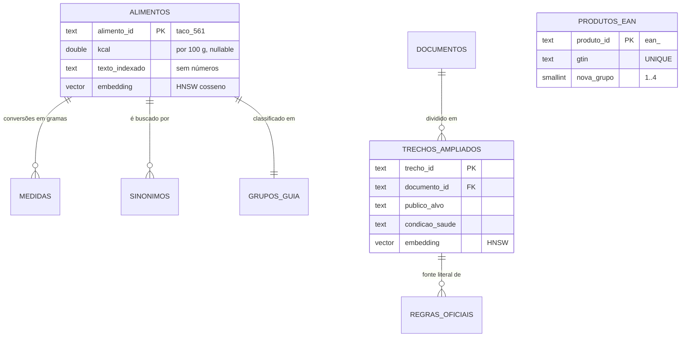

# Banco de dados e fontes

A base de dados do Mira é produzida e publicada pelo repositório [`data`](https://github.com/residencia-ia-Challenge-2/data) (`mira-dados`). O repositório `ia` **só lê** o schema `mira`. Esta página resume o que um desenvolvedor do `ia` precisa saber; a especificação completa está na [documentação do `mira-dados`](https://github.com/residencia-ia-Challenge-2/data/tree/main/docs).

## Regras fixas dos dados

| # | Regra | Como é garantida |
| --- | --- | --- |
| 1 | **Nenhum número vem de LLM.** Composição nutricional vem só de fontes oficiais ou curadas e de cálculo determinístico. | Nenhum módulo de ETL chama LLM; kcal ausente no Open Food Facts não é recalculada. |
| 2 | **Nulo nunca vira zero.** Na TACO, `Tr` → `0.0`; `NA`, `*` e vazio → `NULL`. | Conversão no ETL + regra do Data Quality Gate. |
| 3 | **Texto indexado sem números.** O texto vetorizado de um alimento tem só nome, grupo, preparo e sinônimos. | Regra do Data Quality Gate. |
| 4 | **Avaliação separada da base.** O gabarito (`eval/` do `ia`) nunca entra no banco. | Regra do Data Quality Gate + teste. |
| 5 | **LGPD.** Nenhum dado identificável versionado ou logado. | Recorte do Open Food Facts por lista de permissão de colunas (sem contribuidores). |

## Conteúdo da base

Números do relatório do Data Quality Gate (27 regras bloqueantes, 6 alertas), versão `0002` do schema.

| Tabela | Linhas | Uso no pipeline | Fonte |
| --- | ---: | --- | --- |
| `alimentos` | 597 | Candidatos da busca e nutrientes por 100 g | TACO 4ª ed. |
| `medidas` | 1.580 | Medida caseira → gramas (160 alimentos, 26,8 % da base) | IBGE POF 2008-2009 |
| `sinonimos` | 237 | Normalização e busca de nomes (`macaxeira` → mandioca) | Curadoria + IBGE |
| `grupos_guia` | 597 | Grupo do Guia e grau de processamento | Curadoria do Guia |
| `documentos` | 19 | Catálogo das publicações, com público-alvo e condição de saúde | Guia + 18 publicações do MS |
| `trechos_ampliados` | 2.424 | Trechos usados na orientação (base ampliada), com filtros por público | Guia + 18 publicações do MS |
| `trechos` | 148 | **Legado:** só o Guia, lido pela `v5_rag_completo` | Guia Alimentar 2ª ed. |
| `regras_oficiais` | 15 | 4 recomendações, regra de ouro e Dez passos do Guia, transcritos literalmente | Guia Alimentar 2ª ed. |
| `produtos_ean` | 26.389 | Produtos industrializados por código de barras (ainda não usada: o `backend` consulta a API do Open Food Facts ao vivo) | Open Food Facts, recorte Brasil |
| `metadados` | — | Hashes, versão do schema, modelo de embeddings, aprovação do Data Quality | Publicação |

O diagrama mostra só as colunas principais. Colunas, tipos e índices de todas as tabelas: [Modelo de dados (DER)](https://github.com/residencia-ia-Challenge-2/data/blob/main/docs/definicao/modelo_dados.md).

## Busca e embeddings

| Item | Valor |
| --- | --- |
| Banco | PostgreSQL 17 + `pgvector` |
| Modelo de embeddings | `granite-embedding:278m` (via Ollama), o mesmo no `mira-dados` e no `ia` |
| Dimensão dos vetores | 768 |
| Janela do modelo | 512 tokens; o ETL corta os trechos por tokens reais, então nenhum passa da janela |
| Índices | GIN (full-text) e HNSW (vetorial) em `alimentos` e nos trechos; `pg_trgm` em `alimentos.nome` e `sinonimos.termo` |

## Publicação e versões

A publicação é atômica: os dados entram em `mira_staging`, passam por um *smoke test* e só então trocam de lugar com o schema ativo `mira`. O schema anterior fica em `mira_anterior`, para *rollback*. Experimentos (por exemplo, outro modelo de embeddings) usam `mira_exp_<nome>` e nunca viram produção.

O `ia` confere a base pela tabela `metadados`:

| Chave | Para quê |
| --- | --- |
| `base_sha256` | Mesmo hash que o `hash_base()` do `ia` calcula sobre os Parquets da base |
| `dq_aprovado` | Sempre `true`: a publicação é recusada sem Data Quality aprovado |
| `versao_schema` | Revisão Alembic (hoje `0002`) |
| `modelo_embeddings`, `dimensao` | Devem bater com a configuração do `ia` |

!!! note "Cópias da base"
    Além do PostgreSQL, a base existe em Parquet em dois lugares: no `ia` (os 6 arquivos do `hash_base()`) e no `backend` (`alimentos` e `medidas_caseiras`, em `MIRA_DADOS_DIR`), que faz o cálculo dos nutrientes com a própria cópia. O `backend` compara o `versao_base` devolvido pelo `ia` com o hash da sua cópia e recusa o pedido se forem diferentes.

## Fontes de dados

| Fonte | Uso | Licença | Situação |
| --- | --- | --- | --- |
| TACO 4ª ed. (NEPA/Unicamp, 2011) | Nutrientes por 100 g | Reprodução permitida com citação da fonte | Em uso |
| IBGE POF 2008-2009 (Medidas Referidas) | Medidas caseiras → gramas | Dado público do IBGE | Em uso |
| Guia Alimentar 2ª ed. + 18 publicações do MS | Orientação qualitativa, grupos e regras oficiais | Publicações públicas do MS | Em uso |
| Open Food Facts (recorte Brasil) | Produtos por código de barras | ODbL 1.0 (base) + DbCL 1.0 (conteúdo); atribuição e *share-alike* | Na base (`produtos_ean`); o `backend` usa hoje a API ao vivo |
| TBCA | Alimentos fora da TACO | A verificar | Futuro |
| USDA | Citado na P03 da v1 das Definições | — | Removido na v2 |

Cada fonte tem manifesto com URL e SHA-256 e arquivo `.dvc` no Git. Licenças completas em `data/curadoria/nutricional/fontes_tabelas.csv`; histórico de admissão no [Registro de datasets](https://github.com/residencia-ia-Challenge-2/data/blob/main/docs/REGISTRO_DATASETS.md).

## Escopo da base: MVP e ampliada

A curadoria marca cada alimento com `escopo`: **`mvp`** (29 alimentos, a base da Etapa 0) ou **`ampliacao`** (131 alimentos, ADR-029). Com `base.ampliada: true` no `params.yaml` do `mira-dados` (o padrão atual), a busca usa a TACO inteira. Com `false`, volta à base da Etapa 0, o que mantém as etapas antigas comparáveis.

A lista dos alimentos de cada escopo está em `data/curadoria/nutricional/alimentos.csv`, no `mira-dados`.

**Fontes:** documentação do `mira-dados`: [Início](https://github.com/residencia-ia-Challenge-2/data/blob/main/docs/index.md), [Contexto e regras fixas](https://github.com/residencia-ia-Challenge-2/data/blob/main/docs/definicao/contexto.md), [Fontes](https://github.com/residencia-ia-Challenge-2/data/blob/main/docs/definicao/fontes.md), [Modelo de dados](https://github.com/residencia-ia-Challenge-2/data/blob/main/docs/definicao/modelo_dados.md) e [Integração com o `ia`](https://github.com/residencia-ia-Challenge-2/data/blob/main/docs/arquitetura/integracao_ia.md).
