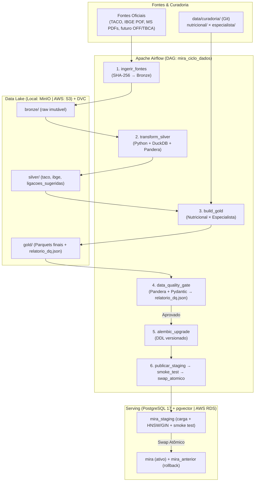
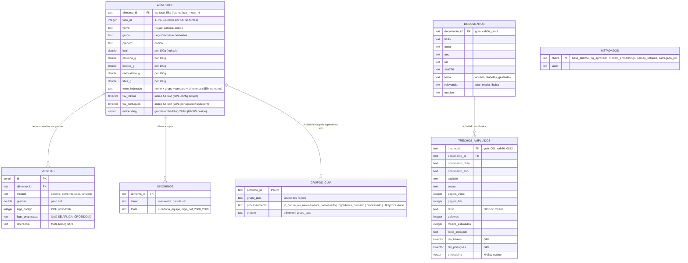
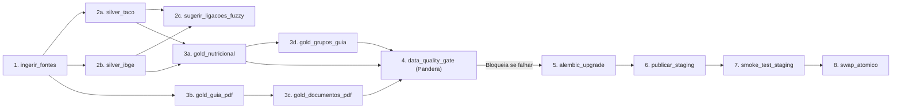

# Blueprint de engenharia de dados (histórico)

!!! warning "Documento histórico"
    Esta é a especificação original usada para criar o repositório `data` (`mira-dados`), escrita antes da implementação. Ela foi migrada do próprio repositório `data` para cá sem alterações de conteúdo. **Não descreve o estado atual**: por exemplo, o MinIO foi trocado pelo SeaweedFS (decisão D21), o Data Quality Gate tem hoje 35 regras bloqueantes e os itens das seções 8 e 9 já foram implementados. O estado atual está na seção [Dados](../dados/index.md).

    As referências "blueprint 8.1", "blueprint 9.1" etc. nas decisões e no código apontam para as seções deste documento.

> **Propósito deste documento:** especificação técnica **autocontida** para ser levada a outro repositório (`mira-dados`) e executada por outro agente/equipe em uma nova sessão, separando definitivamente o **ciclo de vida dos dados** do repositório de aplicação/IA (`ia`).

---

## 1. Contexto do Projeto e Fronteira entre Repositórios

O **Mira (FoodScan)** transforma descrições/entradas de refeições em itens alimentares, gramas, calorias, macronutrientes e orientação qualitativa baseada no Guia Alimentar e em publicações do Ministério da Saúde.

### Separação de responsabilidades (`mira-dados` × `ia`)

| Repositório | Dono de quê | O que **produz** | O que **não** contém |
| --- | --- | --- | --- |
| **`mira-dados`** *(este blueprint)* | Fontes brutas, ETL, curadoria/rotulação, Data Quality, migrações DDL, embeddings em lote e publicação no banco | Camadas `Bronze → Silver → Gold` em S3/MinIO + tabelas populadas e indexadas no schema `mira` do PostgreSQL (`pgvector`) | Código da API FastAPI, prompts de LLM, pipelines RAG (`v1..v5`), gabarito de avaliação (`eval/queries.jsonl`) |
| **`ia`** *(aplicação / ML / RAG)* | Pipelines RAG, LLM, avaliação científica (`eval/`), API FastAPI e interface Streamlit | Endpoints `/v1/*`, métricas de avaliação, inferência | DDL de criação do banco, carga destrutiva, download/parsing de PDFs ou planilhas |

### Regras fixas herdadas do projeto (não violar sem ADR)
1. **Nenhum número vem de LLM:** composição nutricional vem exclusivamente de fontes oficiais/curadas e cálculo determinístico (`gramas × valor por 100 g`).
2. **Nulo nunca vira zero:** na TACO, `"Tr"` (traço) → `0.0`; `"NA"`, `"*"` e vazio → `None` (`NULL`); carboidrato entre `-0.5` e `0.0` → `0.0` (marcador `negativo`), abaixo de `-0.5` é erro.
3. **Texto indexado de alimento sem números:** o texto vetorizado (`texto_indexado`) contém apenas nome, grupo, preparo e sinônimos — **nunca** calorias ou macros, para não enviesar busca nem LLM.
4. **Avaliação separada da base:** o conjunto anotado (`eval/queries.jsonl` no repo `ia`) **nunca** entra no banco nem é usado como regra de negócio; serve apenas para medir a IA.
5. **LGPD:** nenhuma refeição identificável de usuário é versionada no Git ou em logs sem anonimização.

---

## 2. Stack Tecnológica (Local Open-Source ↔ Produção AWS)

Todo componente roda **100 % local via Docker + Python** e possui paridade direta para subir na **AWS** sem reescrever o pipeline:

| Camada | Ferramenta Open-Source (Local/Dev) | Equivalente Direto na AWS (Prod) | Função no Ciclo |
| --- | --- | --- | --- |
| **Object Storage (Data Lake)** | **MinIO** (Docker, API S3) + **Parquet** | **Amazon S3** | Armazena `bronze/`, `silver/`, `gold/` e relatórios DQ |
| **Versionamento de Dados** | **DVC** (remote S3) | **DVC** apontando para **Amazon S3** | Versiona hashes e linhagem dos arquivos no Git (`*.dvc`, `dvc.lock`) |
| **Engine ETL / Processamento** | **Python 3.11+ + DuckDB + Pandas/PyArrow** | **AWS ECS Task / AWS Batch** | Lê Parquet/JSONL/S3 em alta velocidade sem precisar de cluster Spark |
| **Orquestração & Agendamento** | **Apache Airflow** (Docker) | **Amazon MWAA** | Executa DAGs com retries, alertas, backfill e UI de observabilidade |
| **Contratos & Data Quality** | **Pydantic v2 + Pandera** | Mesmo container na DAG | Valida schemas e regras de negócio; bloqueia promoção se falhar |
| **Serving (Relacional + Vetorial)** | **PostgreSQL 17 + `pgvector`** (Docker) | **Amazon RDS / Aurora PostgreSQL (`pgvector`)** | Armazena fatos nutricionais + índices `GIN` (`tsvector`) e `HNSW` (vetores) |
| **Migrações de Schema (DDL)** | **Alembic** | Mesmo container contra **RDS** | Evolução versionada do schema SQL (substitui `DROP SCHEMA` direto) |
| **Embeddings (Batch)** | **Ollama (`granite-embedding:278m`)** | Container Ollama / Bedrock / Endpoint dedicado | Vetoriza alimentos e trechos documentais com cache por hash |
| **CI/CD & IaC** | **GitHub Actions + Docker + Terraform** | **Amazon ECR + S3 + RDS + MWAA** | Testes sem rede, lint, build de imagem e provisionamento reproduzível |

---

## 3. Arquitetura de Dados, Rotulação e Esquema (DER)

### 3.1 Arquitetura do Ciclo de Vida (Medalhão + Orquestração)



### 3.2 Os 4 Tipos de Rotulação (Separação Obrigatória)

| Tipo de Rotulação | O que rotula | Onde fica | Responsável | Entra no Serving (`mira`)? |
| --- | --- | --- | --- | --- |
| **1. Rotulação Técnica (Ligação)** | TACO ↔ IBGE (`561` ↔ `6303102 FEIJAO`), sinônimos (`macaxeira = mandioca`) | `data/curadoria/nutricional/` (`mira-dados`) | Eng. de Dados (+ revisão da equipe) | **Sim** (`medidas`, `sinonimos`) |
| **2. Rotulação Documental Oficial** | Grupo do Guia, processamento NOVA, `tema`/público dos PDFs, ancorados em fonte oficial MS | `data/curadoria/especialista/` (`mira-dados`) | Equipe (baseada nos docs oficiais) | **Sim** (`grupos_guia`, `documentos`) |
| **3. Rotulação de Avaliação (Ground Truth)** | Gabarito de refeições e veredito humano do LLM-juiz | `eval/` no repositório **`ia`** | Ciência de Dados + Equipe | **NUNCA** (só mede a IA) |
| **4. Rotulação Multimodal (Futuro)** | Classes de foto (`"arroz_branco"` → `taco_3`) ou validação OCR | `data/rotulos/visao/` (ou repo de Visão) | Visão Computacional | **Indireto** (aponta para `alimento_id`) |

**Governança sem Nutricionista no Time (Ancoragem em Fontes Oficiais):**
- Como a equipe não possui profissional de nutrição, **nenhuma regra clínica é inventada**: toda classificação em `especialista/` traz a coluna `evidencia_fonte` apontando para o capítulo/página do Guia Alimentar ou publicação do Ministério da Saúde.
- Para as ligações TACO ↔ IBGE (que são apenas *Entity Matching* de nomes em português, pois os pesos já são oficiais do IBGE POF), usar **matching assistido (embeddings + LLM local gerando top-3 candidatos)** seguido de revisão rápida pela própria equipe; casos ambíguos ficam sem medida para o usuário informar em gramas (`/v1/recalcular`).

**Estados obrigatórios de aprovação nos CSVs de curadoria (`status`):**
- `proposto_agente`: gerado por script/fuzzy/LLM, ainda não revisado.
- `a_revisar`: pendente com ressalva registrada em `observacao`.
- `aprovado_equipe`: revisado pela equipe e ancorado em fonte oficial (`evidencia_fonte`).

---

### 3.3 Esquema de Dados no PostgreSQL (DER Aprovado)



> **Compatibilidade com o repositório `ia` atual:** enquanto `ia` ainda lê `mira.trechos` na `v5_rag_completo`, manter a tabela/view `trechos` populada (ou view materializada filtrando `documento_id = 'guia'` de `trechos_ampliados`).

---

## 4. Regras de Parsing, Limpeza e Contratos Pandera (Conhecimento do MVP)

O agente que construir `mira-dados` **precisa preservar exatamente** estas descobertas das fontes brasileiras:

1. **TACO 4ª Edição (`taco_4a_edicao_2011.xls`, aba `CMVCol taco3`):**
   - 597 alimentos (`taco_id` de `1` a `597`), 15 grupos.
   - Cabeçalho de 3 linhas se repete a cada quebra de página e deve ser descartado.
   - Linhas com o nome do grupo antecedem os itens e viram a coluna `grupo`.
   - Marcadores: `"Tr"` → `0.0`; `"NA"`, `"*"`, vazio → `None`; `-0.5 < x < 0` → `0.0` (marcador `negativo`).
   - Conferências de sanidade obrigatórias (testes): `taco_id=3` (*Arroz, tipo 1, cozido*) ≈ `128 kcal`; `taco_id=561` (*Feijão, carioca, cozido*) ≈ `76 kcal`; `taco_id=410` (*Frango, peito, sem pele, grelhado*) ≈ `159 kcal`; `taco_id=458` (*Leite integral*) tem `kcal=None` (`*`).

2. **IBGE Medidas Referidas POF 2008-2009 (`ibge_medidas_referidas_pof2008_2009.zip` → `tabelamedidas_bd.xls`):**
   - Aba `Tab_Medidas Caseiras`, cabeçalho na linha 4 (`header=3`), 11.801 medidas de 1.124 nomes.
   - **Chave composta obrigatória:** códigos IBGE são reutilizados por nomes distintos (ex.: `8570328`), então a chave única de alimento no IBGE é `(ibge_codigo, ibge_alimento, ibge_preparacao)`.
   - No arquivo original, "cozido" vem grafado como `CROZIDO(A)`. Ignorar medidas `"g"` e `"kg"` na tabela `medidas_caseiras` (conversão direta em código).

3. **PDFs do Guia Alimentar + 18 Publicações do MS (PyMuPDF):**
   - **Guia (`guia_alimentar_2ed.pdf`, pp. 11–129):** gera exatamente 147 trechos (`guia_001`..`guia_147`), sem cruzar seções.
   - **18 publicações MS:** estrutura tipográfica relativa (`corpo` = tamanho com mais caracteres; `título` ≥ `1.15 × corpo` ou negrito em bloco de 1 linha; `capítulo` ≥ `1.5 × corpo`; cabeçalhos/rodapés ≥ 25 % das páginas removidos; seções de Referências/Sumário/Ficha Catalográfica ignoradas).
   - **Ponto de atenção conhecido (512 tokens):** `granite-embedding:278m` tem janela máxima de **512 tokens**. Hoje 30 de 2.394 trechos passam de 512 tokens porque o corte usa `160–265 palavras`. O *Data Quality Gate* deve registrar essa contagem como **alerta** inicialmente (e futuramente cortar sentenças por contagem real de tokens).

### Contratos Pandera (Código-modelo para `src/mira_dados/contratos.py`)

```python
import pandera.pandas as pa
from pandera.typing import Series

class TacoSilverSchema(pa.DataFrameModel):
    taco_id: Series[int] = pa.Field(ge=1, le=597, unique=True)
    nome: Series[str] = pa.Field(str_length={"min_value": 2})
    grupo: Series[str] = pa.Field(str_length={"min_value": 2})
    kcal: Series[float] = pa.Field(nullable=True, ge=0, le=900)
    proteina_g: Series[float] = pa.Field(nullable=True, ge=0, le=100)
    lipidios_g: Series[float] = pa.Field(nullable=True, ge=0, le=100)
    carboidrato_g: Series[float] = pa.Field(nullable=True, ge=0, le=100)
    fibra_g: Series[float] = pa.Field(nullable=True, ge=0, le=100)

class AlimentoGoldSchema(pa.DataFrameModel):
    alimento_id: Series[str] = pa.Field(str_matches=r"^taco_\d+$", unique=True)
    taco_id: Series[int] = pa.Field(ge=1, le=597, unique=True)
    nome: Series[str] = pa.Field(str_length={"min_value": 2})
    grupo: Series[str] = pa.Field(str_length={"min_value": 2})
    kcal: Series[float] = pa.Field(nullable=True, ge=0, le=900)
    exigido_mvp: Series[bool]

class MedidaGoldSchema(pa.DataFrameModel):
    alimento_id: Series[str] = pa.Field(str_matches=r"^taco_\d+$")
    medida: Series[str] = pa.Field(str_length={"min_value": 1})
    gramas: Series[float] = pa.Field(gt=0, le=10000)
    ibge_codigo: Series[int] = pa.Field(ge=1_000_000, le=9_999_999)
    ibge_preparacao: Series[str] = pa.Field(str_length={"min_value": 2})
```

---

## 5. Estrutura Alvo do Novo Repositório `mira-dados`

```text
mira-dados/
├── .github/workflows/
│   └── ci.yml                       # ruff + pytest + validação DAG Airflow + dvc status
├── .dvc/
│   └── config                       # remote S3 (MinIO local em dev / Amazon S3 em prod)
├── alembic/
│   ├── env.py
│   └── versions/
│       └── 0001_schema_inicial.py   # DDL completo: alimentos, medidas, sinonimos, grupos_guia, documentos, trechos_ampliados, metadados
├── data/
│   ├── raw/                         # [Bronze] arquivos .dvc (nunca binários no Git)
│   ├── interim/                     # [Silver] taco.parquet, ibge_medidas.parquet, ligacoes_sugeridas.csv
│   ├── curadoria/                   # [Humano - Git] separado por domínio:
│   │   ├── nutricional/
│   │   │   ├── fontes_tabelas.csv   # manifesto único (TACO, IBGE) com URL e SHA-256
│   │   │   ├── alimentos.csv        # unifica mvp + ampliacao (colunas: taco_id,escopo,exigido_por,status,observacao)
│   │   │   ├── ligacoes_ibge.csv    # unifica ligacoes (colunas: ...,escopo,origem,status,observacao)
│   │   │   └── sinonimos.csv        # unifica sinonimos (colunas: taco_id,termo,escopo,fonte,status,observacao)
│   │   └── especialista/
│   │       ├── documentos.csv       # catálogo das 19 publicações MS (URL, SHA-256, tema, relevancia, status)
│   │       ├── grupos_guia.csv      # unifica grupos_guia (colunas: ...,escopo,status,evidencia_fonte,observacao)
│   │       └── regras_oficiais.csv  # regras qualitativas citando capítulo/página do Guia/MS (sem opinião clínica)
│   └── processed/                   # [Gold] Parquets + relatorio_base.json + relatorio_dq.json
├── orchestration/
│   ├── Dockerfile                   # Imagem Airflow + dependências Python de mira-dados
│   └── dags/
│       └── mira_ciclo_dados.py      # DAG orquestradora (chama módulos idempotentes)
├── src/mira_dados/
│   ├── caminhos.py
│   ├── contratos.py                 # Schemas Pandera + Pydantic
│   ├── ingerir.py                   # Download + conferência SHA-256 via manifestos + sync Bronze
│   ├── silver/
│   │   ├── taco.py
│   │   ├── medidas.py
│   │   └── ligacoes.py
│   ├── gold/
│   │   ├── base_nutricional.py      # antigo base_mvp.py (filtra escopo e curadoria.status_permitidos)
│   │   ├── guia.py
│   │   ├── documentos.py
│   │   └── grupos_guia.py
│   ├── qualidade.py                 # Data Quality Gate (Pandera + integridade + cobertura + tokens) → relatorio_dq.json
│   └── publicar_postgres.py         # Embeddings + carga em mira_staging + smoke test + swap atômico + rollback
├── infra/terraform/                 # Esqueleto modular AWS (S3 bucket, RDS Postgres pgvector, ECR)
├── tests/
│   ├── test_etl.py
│   ├── test_qualidade.py
│   ├── test_publicar_postgres.py
│   └── test_dag_integridade.py      # Valida import e ausência de ciclos na DAG do Airflow
├── alembic.ini
├── docker-compose.yml               # postgres (pgvector:pg17) + minio + airflow (profile opcional)
├── dvc.yaml
├── params.yaml
├── pyproject.toml                   # Python 3.11+, pandas, pyarrow, duckdb, pandera, pydantic, alembic, psycopg, pymupdf, dvc[s3]
└── Makefile
```

---

## 6. Especificação das Tasks do Apache Airflow (`mira_ciclo_dados`)

**Princípio de desenvolvimento:** o arquivo `orchestration/dags/mira_ciclo_dados.py` **não implementa regra de negócio**; ele apenas encadeia os entrypoints `python -m mira_dados.*` (via `BashOperator` em dev ou `DockerOperator` / `EcsRunTaskOperator` na AWS).



### Contrato de cada Task

1. **`ingerir_fontes` (`python -m mira_dados.ingerir`)**
   - *Retries:* `3` (backoff exponencial de 30 s para instabilidade de rede).
   - *Comportamento:* lê `fontes_tabelas.csv` e `especialista/documentos.csv`, baixa apenas arquivos ausentes em `data/raw/`, valida SHA-256 (falha imediatamente se houver divergência) e opcionalmente executa `dvc push` para o remote S3/MinIO.
2. **`silver_taco` (`python -m mira_dados.silver.taco`)** & **`silver_ibge` (`python -m mira_dados.silver.medidas`)**
   - Rodam em paralelo. Validam cada saída com `TacoSilverSchema` / `IbgeSilverSchema` (Pandera). `retries=0` para erros de schema.
3. **`sugerir_ligacoes_fuzzy` (`python -m mira_dados.silver.ligacoes`)**
   - Gera `data/interim/ligacoes_sugeridas.csv` via `rapidfuzz` apenas como insumo para revisão humana. Não bloqueia publicação.
4. **`gold_nutricional` (`python -m mira_dados.gold.base_nutricional`)**
   - Lê `params.yaml` (`base.ampliada`, `base.incluir_distratores`, `curadoria.status_permitidos`).
   - Filtra `escopo` (`mvp` vs `mvp + ampliacao`) e `status` permitidos para o ambiente (`dev` vs `prod`).
   - Garante invariância: com `base.ampliada=false` deve produzir exatamente os mesmos dados da Etapa 0 do repo `ia`.
5. **`gold_guia_pdf` (`guia.py`) → `gold_documentos_pdf` (`documentos.py`)** & **`gold_grupos_guia` (`grupos_guia.py`)**
   - Processam os PDFs e a classificação do especialista.
6. **`data_quality_gate` (`python -m mira_dados.qualidade --estrito`)**
   - Valida `AlimentoGoldSchema`, `MedidaGoldSchema`, integridade referencial entre todos os Parquets e catálogos, unicidade de chaves e regras nutricionais.
   - Grava `data/processed/relatorio_dq.json` com bloco `bloqueantes`, `alertas` (trechos > 512 tokens, ligações ainda em `a_revisar`) e `cobertura`. **Aborta a DAG** se qualquer bloqueante falhar.
7. **`alembic_upgrade` (`alembic upgrade head`)**
   - Garante que as tabelas e extensões (`vector`, `unaccent`) existam no PostgreSQL/RDS antes da carga.
8. **`publicar_staging` → `smoke_test_staging` → `swap_atomico` (`python -m mira_dados.publicar_postgres --fase ...`)**
   - **`staging`**: gera embeddings com cache, carrega `mira_staging` do zero, cria índices `GIN` (`tsv_tokens`, `tsv_portugues`) e `HNSW` (`embedding vector_cosine_ops`) e grava `mira_staging.metadados` (`base_sha256`, `dq_aprovado`, `modelo_embeddings`, `carregado_em`).
   - **`smoke`**: verifica contagens mínimas, `base_sha256` e executa 3 buscas híbridas de sanidade em `mira_staging`.
   - **`swap`**: em transação única (`BEGIN; DROP SCHEMA IF EXISTS mira_anterior CASCADE; ALTER SCHEMA mira RENAME TO mira_anterior; ALTER SCHEMA mira_staging RENAME TO mira; COMMIT;`). O schema `mira` ativo nunca fica indisponível.

---

## 7. Checklist de Implementação (Para o Agente na Nova Sessão)

> **Instrução para o próximo agente:** execute na ordem abaixo, validando cada marco antes de seguir para o próximo.

### Fase 1 — Bootstrap e Migração Limpa do Repo `ia` → `mira-dados`
- [ ] Inicializar estrutura do repositório `mira-dados` (`pyproject.toml` com `pandas`, `pyarrow`, `duckdb`, `pandera`, `pydantic`, `alembic`, `psycopg[binary]`, `pymupdf`, `rapidfuzz`, `dvc[s3]`, `httpx`).
- [ ] Copiar `data/raw/FONTES.md` e arquivos `.dvc` de `ia/data/raw/` mantendo exatamente os mesmos hashes SHA-256.
- [ ] Migrar e reorganizar os CSVs de `ia/data/curadoria/` para `data/curadoria/nutricional/` e `data/curadoria/especialista/` adicionando as colunas `escopo` (`mvp` | `ampliacao`) e `status`.
- [ ] Portar `taco.py`, `medidas.py`, `ligacoes.py`, `base_mvp.py` (`base_nutricional.py`), `guia.py`, `documentos.py`, `grupos_guia.py` e criar `ingerir.py` lendo os manifestos.
- [ ] **Prova de invariância:** rodar `dvc repro` com `base.ampliada=false` e `true` e comparar os Parquets gerados com os do repositório `ia` (conteúdo idêntico).

### Fase 2 — Qualidade (Pandera), Alembic e Publicação Atômica
- [ ] Implementar `contratos.py` (Pandera) e `qualidade.py` (`validar_qualidade` no `dvc.yaml` → `relatorio_dq.json`).
- [ ] Configurar `alembic/` com migração inicial `0001_schema_inicial.py` (incluindo suporte ao schema alvo parametrizável `mira_staging` / `mira`).
- [ ] Implementar `publicar_postgres.py` com as fases `staging`, `smoke`, `swap` e `rollback`.
- [ ] Escrever `tests/test_etl.py`, `tests/test_qualidade.py` e `tests/test_publicar_postgres.py` (testando preservação do schema ativo quando o smoke test falha).

### Fase 3 — Docker (Postgres + MinIO + Airflow), DAG e CI/CD
- [ ] Configurar `docker-compose.yml` com:
  - `postgres` (`pgvector/pgvector:pg17`)
  - `minio` + `minio-init` (criando bucket `mira-dados` com política local)
  - `airflow` (`postgres` metadata + webserver + scheduler, sob `--profile airflow`)
- [ ] Configurar `.dvc/config` apontando para o remote S3 (endpoint MinIO local via variável/config local, compatível com Amazon S3 em prod).
- [ ] Implementar `orchestration/dags/mira_ciclo_dados.py` e `tests/test_dag_integridade.py`.
- [ ] Criar `Makefile` (`up`, `ingest`, `data`, `dq`, `db-migrate`, `db-publish`, `db-rollback`, `test`, `lint`), `.github/workflows/ci.yml` (`ruff`, `pytest`, `dvc status`) e esqueleto `infra/terraform/` (S3, RDS PostgreSQL, ECR).
- [ ] Integrar com o repo `ia`: apontar `DATABASE_URL` do `ia` para o PostgreSQL populado pelo `mira-dados` e rodar a suíte de testes de integração (`test_v4_banco.py`, `test_v5_orientacao.py`, `test_documentos.py`) no `ia` para confirmar 100 % de compatibilidade.

---

## 8. Busca, Curadoria e Ingestão de Novos Datasets (Expansão das Features)

Esta etapa faz parte formal do ciclo de Engenharia de Dados para suprir as lacunas da base atual (`597` alimentos, só `26,8 %` com medidas caseiras e ausência de industrializados/fotos) quando o núcleo de `mira-dados` (Fases 1–3) estiver estável.

### 8.1 Protocolo de Admissão de Novo Dataset (Antes de escrever ETL)
Todo dataset candidato precisa passar por este checklist antes de entrar em `data/raw/`:
- [ ] **Licença e Termos de Uso:** confirmar permissão explícita para uso no projeto (ex.: ODbL, CC-BY, domínio público governamental; verificar termos da TBCA antes de ingerir).
- [ ] **Chave Canônica e Rastreabilidade:** definir prefixo único de `alimento_id` (`taco_*`, `tbca_*`, `ean_*`) e registrar URL/SHA-256 no manifesto.
- [ ] **Contrato e Quality Gate:** escrever o schema Pandera de entrada (`Silver`) e as regras físicas de bloqueio antes de promover para `mira_staging`.
- [ ] **Impacto no `eval/`:** novos datasets nunca podem vazar regras ad-hoc baseadas apenas nas 15 queries de teste do repo `ia`.

### 8.2 Fontes Mapeadas por Feature

| Feature | Datasets / Fontes Recomendadas | Como Ingerir e Limpar no `mira-dados` |
| --- | --- | --- |
| **Código de Barras (Industrializados / EAN)** | 1. **Open Food Facts (OFF):** dump `.jsonl.gz` (`static.openfoodfacts.org`) filtrado para `countries_tags: en:brazil` + API v2 fallback<br>2. **Bluesoft Cosmos API:** apoio de metadados (nome comercial, marca, NCM) quando faltar no OFF<br>3. **OCR Rótulo (Anvisa RDC 429/2020 + IN 75/2020):** captura guiada no app (valores por `100 g / 100 ml`) | • Processar o `.jsonl.gz` via **DuckDB** filtrando Brasil.<br>• **DQ Gate físico obrigatório** (bases colaborativas têm muito ruído): validar `4*P + 4*C + 9*L ≈ kcal` (±25 %), soma de macros `<= 105 g/100 g`, detectar `kJ` salvo errado como `kcal` e porção salva como `_100g`.<br>• Gravar em `mira.produtos_ean` (índice B-tree em `gtin`) + incluir `grupo_nova` (`1..4`) e campos RDC 429 (`acucares_adicionados_g`, `gordura_saturada_g`, `sodio_mg`). |
| **Escolha Manual + Cobertura de Alimentos e Medidas** | 1. **TBCA (USP)** (após validar termos de uso)<br>2. **IBGE POF 2008-2009** (reaproveitar todas as 11.801 medidas com matching assistido)<br>3. **Produtos limpos do OFF Brasil** | • Conector `silver/tbca.py` + `alimento_id` multi-fonte (`tbca_*`).<br>• **Aceleração das 136 ligações pendentes TACO↔IBGE:** gerar top-3 candidatos por embeddings + LLM local, priorizando carnes/pescados e alimentos frequentes; revisão humana da equipe em lote.<br>• Criar índice `pg_trgm` (GIN/GiST) sobre `nome` + `sinonimos` para autocomplete instantâneo (`< 50 ms`, sem LLM). |
| **Visão Computacional (Pratos Brasileiros)** | 1. **Datasets BR:** *Brazilian Food Images* (Mendeley Data, 20 classes com máscaras), *MyFood Dataset* (Zenodo DOI `10.5281/zenodo.4041488`), *Typical Brazilian Foods* (Kaggle)<br>2. **Pré-treino global:** *Food-101*, *UECFOOD-100/256*, *FoodSeg103*<br>3. **Coleta própria (LGPD):** fotos sem EXIF/pessoas | • O dataset de imagens pode ficar no repositório/bucket de Visão, mas o **contrato de classes** (`data/curadoria/nutricional/visao_classes.csv`) mora junto à base nutricional mapeando `classe_visual → alimento_id` + porção padrão.<br>• Nenhum modelo de Visão estima kcal: emite `ItemExtraido` para o mesmo cálculo determinístico. |
| **RAG Avançado & Feedback Loop** | 1. Manter as 19 publicações oficiais MS (ou novas portarias/protocolos)<br>2. **Eventos anônimos de uso (LGPD)** | • Registrar apenas termos normalizados que falharam (`sem_alimento`, `sem_medida`) e ajustes de gramas (`/v1/recalcular`) para priorizar onde ampliar a curadoria. |

---

## 9. Contrato de Handoff para Ciência de Dados (RAG Mais Completo)

Para que o Cientista de Dados consiga evoluir o RAG no projeto final sem precisar mexer em ETL, o `mira-dados` deve entregar **3 garantias operacionais**:

1. **Chunking sem truncamento + Metadados de filtro (`tema` / público):**
   - Corrigir os **30 de 2.394 trechos** que hoje excedem 512 tokens cortando por **contagem real de tokens** (tokenizer do modelo) em vez de palavras.
   - Expor `tema`, `relevancia` e `publico_alvo` na tabela/busca de `trechos_ampliados`, permitindo ao Cientista filtrar recomendações incompatíveis (ex.: não trazer trecho infantil ou de diabetes quando não se aplica).
2. **Suporte a Ablações Isoladas (`mira_exp_<nome>`):**
   - Parametrizar `embeddings.modelo` e `chunking.max_tokens` no `params.yaml`.
   - Permitir publicar testes do Cientista em um schema experimental (`python -m mira_dados.publicar_postgres --schema mira_exp_bgem3`) sem derrubar nem contaminar o schema `mira` de produção.
3. **Checklist de Prontidão (Eng. de Dados → Ciência de Dados):**
   - [ ] `relatorio_dq.json` aprovado (`0` erros bloqueantes e `0` trechos acima da janela do embedding).
   - [ ] Cobertura de medidas caseiras ampliada além dos `26,8 %` atuais e ligações TACO↔IBGE revisadas pela equipe.
   - [ ] Índices `GIN` (`tsv_tokens`, `tsv_portugues`, `pg_trgm`) + `HNSW` criados e `base_sha256` registrado em `mira.metadados`.
   - [ ] No repositório `ia`, conjunto de avaliação expandido de **15 para 40+ refeições** (com parcela cega sem curadoria ad-hoc) e juiz validado humanamente.

---

## 10. Integração com o Repositório `ia` e Origem do Bootstrap

### 10.1 Origem exata dos artefatos para o Bootstrap
- **Repositório de origem:** `https://github.com/residencia-ia-Challenge-2/ia` (branch `feat/mvp-rag`, ou cópia local correspondente).
- **Mapeamento exato de arquivos a portar (`ia` → `mira-dados`):**

| Origem no `ia` | Destino no `mira-dados` | Observação |
| --- | --- | --- |
| `data/raw/FONTES.md` e `data/raw/*.dvc` | `data/raw/` | Preserva os hashes SHA-256 originais |
| `data/curadoria/alimentos_{mvp,ampliacao}.csv` | `data/curadoria/nutricional/alimentos.csv` | Unificar com coluna `escopo` (`mvp` \| `ampliacao`) |
| `data/curadoria/ligacoes_{taco_ibge,ampliacao}.csv` | `data/curadoria/nutricional/ligacoes_ibge.csv` | Unificar com `escopo` + `status` |
| `data/curadoria/sinonimos{,_ampliacao}.csv` | `data/curadoria/nutricional/sinonimos.csv` | Unificar com `escopo` + `status` |
| `data/curadoria/grupos_guia{,_ampliacao}.csv` | `data/curadoria/especialista/grupos_guia.csv` | Unificar com `escopo`, `status` e `evidencia_fonte` |
| `data/curadoria/documentos.csv` | `data/curadoria/especialista/documentos.csv` | Catálogo das 19 publicações MS |
| `src/mira/dados/{taco,medidas,ligacoes}.py` | `src/mira_dados/silver/` | Preservar `LinhaTaco`, `LinhaMedida` e lógica de parsing |
| `src/mira/dados/{base_mvp,guia,documentos,grupos_guia}.py` | `src/mira_dados/gold/` | Adaptar caminhos para `nutricional/` e `especialista/` |
| `src/mira/dominio/{modelos,orientacao,unidades}.py` + `src/mira/rag/{texto,embeddings}.py` | `src/mira_dados/contratos.py` e `texto.py` / `embeddings.py` | Copiar ou compartilhar via pacote para manter `texto_indexado` e `tokenizar()` idênticos aos do `ia` |
| `src/mira/repositorios/postgres.py` (parte DDL/`carregar()`) | `alembic/` + `src/mira_dados/publicar_postgres.py` | Manter mesmas tabelas/colunas esperadas pelo `ia` |

### 10.2 Acoplamentos a resolver ao conectar `mira-dados` ↔ `ia`
1. **Tabela legada `mira.trechos`:** enquanto o pipeline `v5_rag_completo` (Etapa 5) existir no `ia`, a migração inicial do Alembic (`0001_schema_inicial.py`) e o `publicar_postgres.py` devem continuar criando e populando `mira.trechos` (ou view equivalente filtrando `documento_id = 'guia'` de `trechos_ampliados`), além de `mira.trechos_ampliados`.
2. **Desacoplar `ia` dos Parquets locais (`data/processed/`):**
   - Hoje, `RepositorioPostgres.__init__()` (`src/mira/repositorios/postgres.py`) compara `mira.metadados['base_sha256']` contra `hash_base()` lendo `data/processed/*.parquet` **no disco local do `ia`**.
   - E `src/mira/api/app.py` (`criar_app`) lê `carregar_base()`, `ler_grupos_guia()` e `ler_trechos()` do disco local do `ia`.
   - **Ação necessária no `ia` ao separar os repositórios:**
     - **Opção imediata (transição):** sincronizar `data/processed/` via `dvc pull` apontando para o mesmo bucket S3/MinIO do `mira-dados`.
     - **Opção definitiva (produção):** atualizar `ia` para ler alimentos, medidas, grupos do Guia e trechos diretamente do PostgreSQL (`mira.*`), validando apenas `dq_aprovado == 'true'` e `versao_schema` em `mira.metadados` (sem depender de arquivos locais no container da API).

---

## 11. Comandos de Verificação no Novo Ambiente

```bash
# 1. Qualidade de código, contratos e integridade da DAG
ruff check .
pytest tests/test_etl.py tests/test_qualidade.py tests/test_dag_integridade.py

# 2. Pipeline completo local (Bronze -> Silver -> Gold -> DQ Gate)
python -m mira_dados.ingerir
dvc repro
python -m mira_dados.qualidade --estrito

# 3. Serving atômico com Postgres + MinIO em Docker
docker compose up -d postgres minio
dvc push
alembic upgrade head
python -m mira_dados.publicar_postgres --fase all   # staging -> smoke -> swap
python -m mira_dados.publicar_postgres status
pytest tests/test_publicar_postgres.py
```
